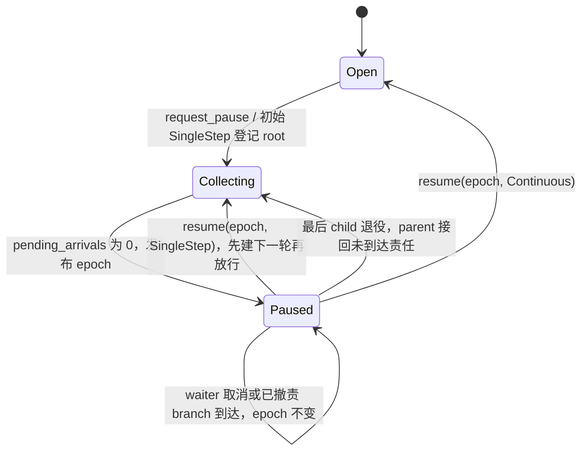
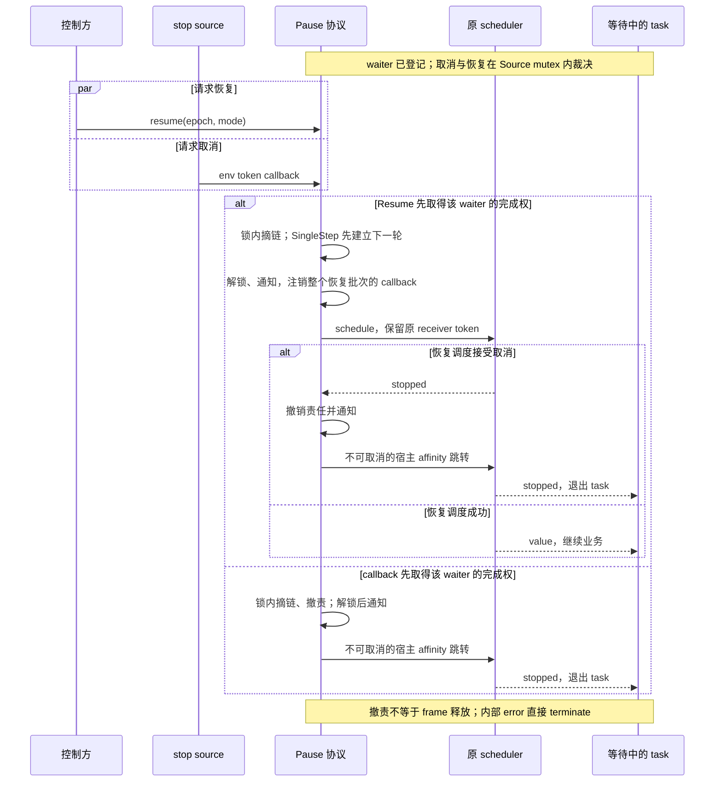
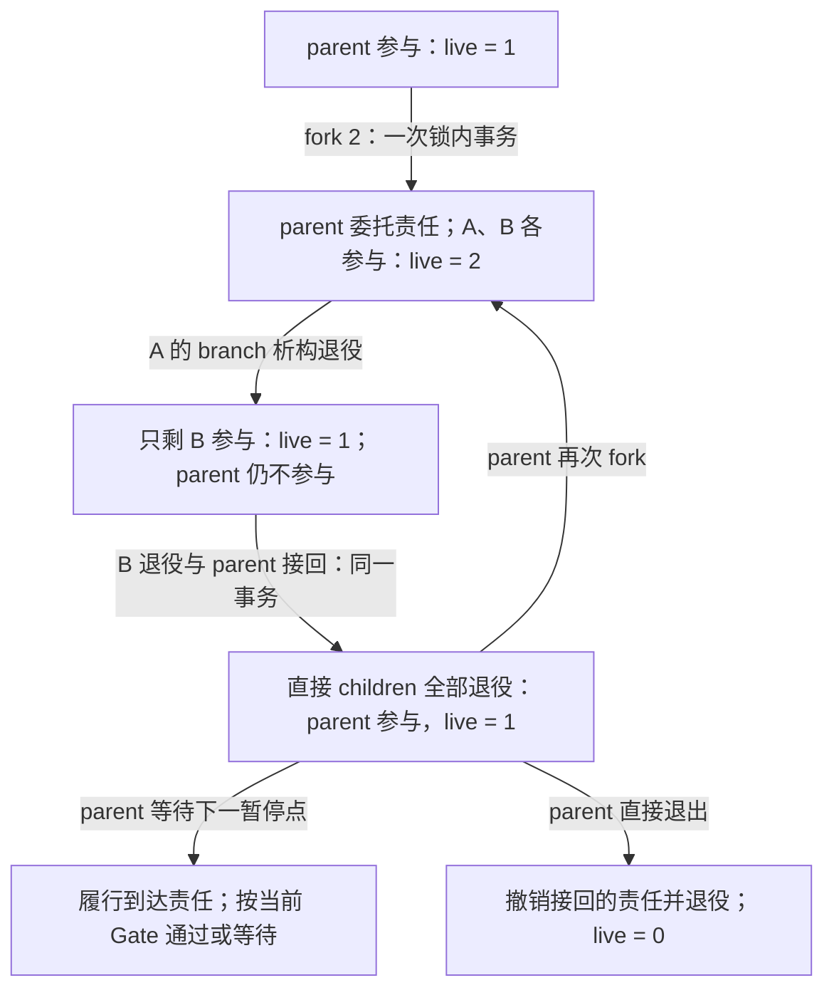

# PauseBranch 设计契约：暂停屏障与执行器恢复

## 1. 文档状态与职责

本文定义公共 API、暂停责任、并发完成协议、执行器恢复和关键伪代码。`pause.hpp` 已实现这些协议；当前回归入口及覆盖范围见[测试指南](../tests/README.md)。

文档同步日期：**2026-11-07**；对应当前 `pause.hpp`、项目版本 **0.1.0**、C++23 和 NVIDIA stdexec 默认提交 `a23aa7abc8796edf158ff67afaf732a6dad3e2a5`。宿主基线为默认 `stdexec::task`、allocator、原生 `run_loop` 和静态线程池；兼容源码覆盖及必要接口检查见 [README 构建说明](../README.md#快速开始)。

本次同步覆盖可选阶段通知、最后一个直接 child 退役时自动归还 parent 责任、默认关闭的独立顶层分支接口、`resume(mode)` 便利重载，以及 Open 路径不读取 scheduler 的实现调整。测试、状态模型和四个短示例已迁移到当前接口。原生调度器回归覆盖 run_loop、1/2/4 worker static_thread_pool、普通 sender 组合与双 worker 并行；实际运行范围见测试指南。本文第 14 节仍是持续有效的验收要求。

2026-10-31 更新：当前默认依赖改为 `a23aa7abc8796edf158ff67afaf732a6dad3e2a5`，
包含 `when_all` 完成/取消竞争修复；已验证原生 run_loop 和静态线程池直接接入，接入方式见
[调度器接入](user-guide.md#调度器接入)，回归入口见[测试指南](../tests/README.md)。
本文章节中的旧提交和审查记录保留其历史含义。新依赖的首次 `request_stop()` 返回 `true`，
重复请求返回 `false`；宿主仍按本文要求显式等待请求线程和完成尾部。
新 task 还会在 stopped 完成时释放 frame，并保留声明的 typed error；
下文旧版 stopped-frame 保留反例及 error 擦除观察已由当前回归中的及时退休和 typed-channel 断言替代。

| 读者关注点 | 阅读入口 |
| --- | --- |
| 应用如何接入、处理错误并关闭 | [使用指南](user-guide.md)、本文第 3、9–12 节 |
| Pause 与宿主各自拥有什么 | 第 2 节职责边界、第 4 节状态图、第 8 节责任转移图 |
| 恢复与取消如何竞争、在哪个资源交付 | 第 6 节时序图与调度规则、第 7 节完成权协议 |
| 为什么选择这些协议、如何证明实现满足要求 | 第 6.5、7.6.5、11.3 节的取舍与边界、第 14 节及测试指南 |

本契约以接口、前置条件、不变量、并发协议、设计取舍和验证映射组织。C++ 工作草案接口与 stdexec 扩展的适用边界见第 3.5 节；这里没有声称已通过 ISO/IEC/IEEE 文档标准认证或原生 `std::execution` 后端验证。

2026-09-24：公共 C++ 命名空间由 `pause` 改为 `coop_pause`，避免与 POSIX 全局函数 `::pause()` 冲突；不提供旧名称别名。调用方需同步改名并重新编译，文件名与 CMake 目标不变；暂停状态机及运行语义不变。

2026-09-23 已采用 `stdexec::task`、公开 `.affine()` 宿主适配及经验证的 scheduler 接入方案。具体后端为固定依赖的 `stdexec::run_loop::scheduler` 与默认 allocator；第 3.4、6.5 节规定接入条件和适配边界。早期组件可行性探针与后续真实 Pause 验收分别记录，不能相互替代。

Pause 是 `stdexec + coroutine` 工作流中的协作式暂停屏障：

- 工作流声明安全暂停点；Pause 不抢占正在执行的动作。
- Pause 保存暂停责任和 waiter，控制方通过 `PauseSource` 请求暂停、主动恢复。
- stdexec 及宿主拥有 stop source、取消传播、scheduler、任务组合和 operation 生命周期。
- Pause 只读取暂停 operation 的 receiver environment token，并响应该 token；不决定整个工作流是否应该停止。
- 业务及外部错误由 stdexec 的 error 通道和宿主处理，Pause 不分类业务错误、不提供恢复确认协议。公开暂停 operation 启动后的内部基础设施错误按第 6.3 节直接终止进程。

`stop_token` 是观察取消的凭证；真正发起停止的是其对应 stop source 的 `request_stop()`，不是修改 token 对象。

全文伪代码接近 C++23，省略 sender 模板样板、部分私有辅助函数声明、枚举作用域前缀和 intrusive hook 实现。`lock(mutex)` 表示当前词法块内的 RAII 加锁；`_locked` 函数只能在 Source 的状态锁内调用。
后文“解锁通知”均指按第 11.1 节规则，仅在完整事务最终阶段改变且对应回调非空时分派，不表示每次 revision 提交都会调用回调。

## 2. 两条完成路径和三个边界

### 2.1 主动恢复与取消退出

暂停操作最终以 value 继续或以 stopped 退出；正常 value 再区分直接通过与等待后恢复：

| 路径 | 触发者 | Pause 内核的结果 | 工作流含义 |
| --- | --- | --- | --- |
| 直接通过 | `start()` 在 Open 取得完成权，未登记 waiter | `set_value(InlinePass{})` | 在当前执行上下文同步提交公开 `set_value()`，不调用 schedule |
| 等待后主动恢复 | 已登记 Waiting，再由 `resume(epoch, mode)` 取得完成权 | `set_value(ResumedPass{})` | 经原 scheduler 调度成功后，提交公开 `set_value()` |
| 取消退出 | 当前 receiver-env token 的 callback | `set_stopped()` | 结束这次等待，沿 stdexec stopped 通道退出，不是正常继续业务 |

控制 API `resume()` 只表示主动放行。取消不调用它，不消费恢复命令，也不替其他分支请求 stop。

同一个暂停操作只会由一条内核完成路径获胜。两种 value 标签仅在内部选择交付方式，不暴露给用户；只有等待后主动恢复才有 Pause 自身的恢复调度。直接被新 task 等待时，stopped 另有第 6.5 节的宿主 affinity 跳转；它不继续业务，也不推迟责任撤销。恢复调度 stopped 沿取消路径退出，内部 error 则直接终止进程，见第 6 节。

### 2.2 Pause 与执行、停止、所有权的边界

```text
宿主结构化作用域
 ├─ stdexec stop source / 根 operation / scheduler
 ├─ PauseSource：暂停门、责任记录、waiter、控制与快照
 ├─ workflow：持有 PauseBranch，在安全位置 co_await
 └─ 控制与观察：借用 PauseSource
```

Pause 不拥有 stop source，不提供停止接口，也不保存整个 scope 的停止状态。Pause callback 赢得取消完成权，或公开暂停 operation 最终以 stopped 完成时，只撤销当前分支的暂停责任；其他分支是否收到取消，由 stdexec 的组合关系决定。token 已被请求停止并不等于 Pause 已观察并接受取消。内部 error 的进程终止策略不属于取消传播。

Source 不拥有线程、任务队列或 coroutine frame。拥有者保证 Source、branch、operation、callback 和 scheduler 的实际使用期。

### 2.3 “原执行器”的准确含义

原执行器是这次暂停 operation 启动时，receiver environment 通过 `stdexec::get_start_scheduler` 声明的 scheduler。选定的默认 `stdexec::task` 返回 `stdexec::task_scheduler`，表示协程的 current scheduler，并保留所需的 stop-token 查询。调用方必须在该 scheduler 对应的执行上下文启动公开暂停 operation；直接通过时本来就在此上下文，无需再提交调度。

这不是从当前线程 TLS 猜测执行器，也不是强制回到同一 OS 线程：

- 一般线程池 scheduler 可以选择另一个 worker，inline scheduler 可以内联；这些是执行资源语义的例子，不代表它们已经通过本版接入验收。
- 首版使用独立驱动的 `run_loop`；其他后端须先按第 3.4 和 14.3 节完成接入验证，不能仅因满足 scheduler concept 就使用。
- 环境必须正确声明实际启动上下文的 scheduler；缺失时编译期拒绝。仅把某个 scheduler 写入 env，并不代表调用线程已经进入它的执行上下文，宿主须通过正确的结构化调度满足此契约。
- 不把 scheduler 存在 Source 中；同一个 Source 的不同分支可以来自不同执行资源。

## 3. 公共 API

### 3.1 值类型与 snapshot

```cpp
namespace coop_pause {

enum class AdvanceMode { Continuous, SingleStep };
enum class PauseOrigin { ControlRequest, SingleStep };
enum class GatePhase { Open, Collecting, Paused };

struct PausePointInfo {
    std::size_t tag = 0; // 不透明诊断编号，不参与决策
};

struct PauseEpoch {
    std::size_t value;
    friend bool operator==(PauseEpoch, PauseEpoch) = default;
};

enum class PauseError {
    RootNotCreated,
    RootAlreadyCreated,
    PauseAlreadyCollecting,
    AlreadyPaused,
    NotPaused,
    StalePauseEpoch,
    InvalidBranchState,
    InvalidForkCount,
    ResourceExhausted
};

struct PauseSnapshot {
    std::size_t revision;
    bool root_created;
    GatePhase phase;
    std::optional<PauseEpoch> paused_epoch;
    std::optional<PauseOrigin> origin;
    std::optional<std::size_t> step_round;
    std::size_t waiting_branch_count;
    std::size_t live_branch_count;
};

struct PausePhaseNotifications {
    std::move_only_function<void() noexcept> on_open_changed;
    std::move_only_function<void() noexcept> on_collecting_changed;
    std::move_only_function<void() noexcept> on_paused_changed;
};

} // namespace coop_pause
```

snapshot 在同一次状态锁临界区复制，是固定大小的拥有型值；计算 waiter 数需要遍历 Waiting 链，整体复杂度为 O(W)：

- `live_branch_count` 是当前参与暂停收敛的有效责任数，不是任务数、record 数或存活协程数。
- `waiting_branch_count` 从共享 Waiting 链表计算，不单独保存。已被 Resume 摘走、仍等待 scheduler 的 operation 不计入该值。
- `revision` 是状态提交序号；`paused_epoch` 是本次暂停屏障的恢复凭证，取建立 Paused 的那次 revision。
- epoch 只适用于产生它的 Source；其值不含 Source 身份，跨 Source 混用不能被可靠检测。
- 后续同轮 waiter 加入或撤销可以改变 revision，而不改变该轮 epoch。
- revision/epoch 使用 `std::size_t`，在当前 x64 基线上为 64 位；本版不将计数回绕纳入保证范围，不增加溢出检查或回绕处理。
- snapshot 不表示 scope 是否 stopped、是否完成或是否可以析构。

### 3.2 PauseSource

```cpp
class PauseSource {
public:
    PauseSource(AdvanceMode initial_mode,
                PausePhaseNotifications notifications = {});
    ~PauseSource() noexcept;

    PauseSource(const PauseSource&) = delete;
    PauseSource& operator=(const PauseSource&) = delete;
    PauseSource(PauseSource&&) = delete;
    PauseSource& operator=(PauseSource&&) = delete;

    [[nodiscard]]
    std::expected<PauseBranch, PauseError> make_root_branch() &;
    std::expected<PauseBranch, PauseError> make_root_branch() && = delete;

#if PAUSE_ENABLE_INDEPENDENT_BRANCH
    [[nodiscard]]
    std::expected<PauseBranch, PauseError> make_branch() &;
    std::expected<PauseBranch, PauseError> make_branch() && = delete;
#endif

    [[nodiscard]]
    std::expected<void, PauseError> request_pause() &;
    std::expected<void, PauseError> request_pause() && = delete;

    [[nodiscard]]
    std::expected<void, PauseError>
    resume(PauseEpoch expected_epoch, AdvanceMode mode) &;
    std::expected<void, PauseError>
    resume(PauseEpoch, AdvanceMode) && = delete;

    [[nodiscard]]
    std::expected<void, PauseError> resume(AdvanceMode mode) &;
    std::expected<void, PauseError> resume(AdvanceMode) && = delete;

    PauseSnapshot snapshot() const & noexcept;
    PauseSnapshot snapshot() const && noexcept = delete;

private:
    const AdvanceMode initial_mode_;
    PausePhaseNotifications notifications_;
    PauseStateData state_; // 按值拥有；构造为 state_(notifications_)
};
```

成员顺序保证阶段通知对象早于 state 构造、晚于 state 析构。三个回调均可为空，通知语义见第 11.1 节。Source 地址稳定，branch 和 operation 借用其状态；控制方直接借用 `PauseSource&`，观察者可借用 `const PauseSource&`。

`make_root_branch()` 一生只能成功一次，但不会启动任务。`root_created` 只记录此初始化事实，不代表根任务仍在运行。

默认接口使用唯一 root 派生责任，工作流内部展开并行责任使用 branch 的 fork。只有在包含头文件前定义 `PAUSE_ENABLE_INDEPENDENT_BRANCH=1`，才公开 `make_branch()`；它创建独立顶层责任，只允许 root 曾创建且 Gate 为 Open。该宏默认值为 0，所有包含本头文件的翻译单元必须取同一值，否则违反 ODR；它是预处理宏，不是当前 CMake 提供的选项。

控制 API 的锁内错误优先级：

| API | 检查顺序 |
| --- | --- |
| `request_pause()` | 无 root → RootNotCreated；Collecting → PauseAlreadyCollecting；Paused → AlreadyPaused；Open → 成功 |
| `resume(epoch, mode)` | 无 root → RootNotCreated；非 Paused → NotPaused；epoch 失配 → StalePauseEpoch；否则成功 |
| `resume(mode)` | 第一次加锁检查 root、Paused 并读取 epoch；解锁后复用双参数校验，不重试竞争失败 |
| `make_root_branch()` | root 已创建 → RootAlreadyCreated |
| `make_branch()`（启用扩展时） | 无 root → RootNotCreated；非 Open → InvalidBranchState |

无 root 的空 Source 可以直接析构。root 创建后，即使当前有效责任为零，也可以请求暂停；空屏障的含义见第 4.4 节。

### 3.3 PauseBranch

```cpp
class PauseBranch {
public:
    PauseBranch(const PauseBranch&) = delete;
    PauseBranch& operator=(const PauseBranch&) = delete;
    PauseBranch(PauseBranch&&) noexcept;
    PauseBranch& operator=(PauseBranch&&) = delete;
    ~PauseBranch() noexcept;

    [[nodiscard]]
    auto suspend_point(PausePointInfo = {}) &;
    auto suspend_point(PausePointInfo = {}) && = delete;

    template<std::size_t N>
    [[nodiscard]]
    std::expected<std::array<PauseBranch, N>, PauseError>
    fork_and_block_self() &;

    [[nodiscard]]
    std::expected<std::vector<PauseBranch>, PauseError>
    fork_and_block_self(std::size_t count) &;

private:
    friend class PauseSource;
    PauseBranch(PauseStateData*, std::unique_ptr<BranchRecord>) noexcept;

    PauseStateData* state_;
    std::unique_ptr<BranchRecord> record_;
};
```

move construction 转移所有权并清空源对象，不改变 record 地址。内部准备对象使用 `state_ == nullptr`，提交登记后才对外发布。

使用契约：

1. 每个 root、child、独立任务在受保护的工作之前，先 `co_await branch.suspend_point()`。
2. sender 必须在该 branch 的结构化生命周期中立即等待；允许保持生命周期、环境和取消传播的 adaptor，不允许保存为未来任务或 detach。
3. 同一 branch 的暂停点、fork、move、析构由持有者串行使用。整个公开暂停 operation 完成前，不能开始下一次使用；使用第 6.5 节的宿主适配时还须覆盖该外层 operation。raw waiter 已摘链或责任已撤销均不等于实际等待已完成。
4. fork 后 parent 不执行受保护的工作。全部直接 child records 退役时自动归还 parent 责任；此后可直接再次 fork，继续受保护业务前仍须等待 parent 的下一次暂停点。
5. 支持结构化 `connect/start` 宿主和测试 receiver；operation 必须单次 start，禁止通过提前销毁来强制取消。

违反结构化使用约束不引入恢复协议。debug assert 辅助诊断，不可继续的不变量破坏 fail-fast。

### 3.4 环境与 completion 契约

首版固定 NVIDIA stdexec 提交 `f0e8ae6fdc6c188389b146bb854b80d399724b04`：

- 实际注册 callback 的 receiver token 必须为 `stdexec::inplace_stop_token`。
- 公开暂停 sender 的 receiver 环境必须可查询 `get_start_scheduler`，其结果满足 scheduler 契约。
- `start()` 的实际执行上下文必须与环境声明一致；这一运行期关系由宿主保证，不能只靠 concept 检查证明。
- 不覆盖 receiver token，不注入第二个 Pause 专属 token，不将 Pause 本体的恢复调度改为不可取消；第 6.5 节独立的宿主 stopped 跳转只交付已确定的停止结果。
- token 类型或 scheduler 查询不兼容的环境在编译期拒绝。环境转发与取消响应的运行期语义还须由集成测试验证，不能仅凭 `scheduler` concept 或 completion signatures 判定兼容。

环境转发是实现义务：Pause 自有 receiver 包装、adaptor 及恢复调度适配层必须保留所需的 forwarding queries，尤其本次公开 receiver 的 `get_stop_token` 查询及其原 `inplace_stop_token`。跨越类型擦除时，必须显式保留查询与取消通道，不能静默退化成 `never_stop_token`。这里的“原 token”以本次公开 Pause operation 的 receiver 环境为边界；例如外层 `when_all` 按其语义提供组内 token 是合法的，Pause 不应绕过它去寻找根 token。

环境能查询到 token 与调度实际接受取消是两项独立要求。除原样转发环境外，实现者还必须使所选 scheduler/task 组合满足第 6.4 节的恢复取消契约。第三方组件不满足时，应选用或适配可满足契约的集成方式，并通过第 14.3 节验收；不能以“使用了 stdexec 组件”为由放宽要求，也不能把 stdexec 内部主动屏蔽取消的路径当作 Pause 恢复调度的合规实现。

本版宿主使用默认 `stdexec::task<T>`，保留默认 `inplace_stop_source`、allocator 和 `exception_ptr` 错误配置；额外环境查询需要显式配置，不能假定外层环境被完整复制。外层同型 token 原样保存，不同型 token 可由 task 桥接，但 Pause 检查的是自己公开 receiver 的实际 token。旧 `exec::task` 不再作为选定宿主；其默认 scheduler 擦除 stop 查询的测试只保留为不兼容对照。

具体 scheduler 的接入在类型擦除之前由宿主保证：

- 首版只接入固定依赖的 `stdexec::run_loop::scheduler` 与默认 allocator，由 `starts_on` 建立执行上下文，再让默认 task 转为 `task_scheduler`。多个分支可以使用不同的 run_loop 实例。
- `task_scheduler` 类型本身不能证明后端合格。来源不明的擦除对象、经 `on/write_env` 注入的未验证当前后端、自定义 TaskEnv/allocator 均不在首版范围；公开 Pause 的类型检查不能恢复已经擦除的后端信息。此限制约束启动 Pause 的 task 当前资源，不禁止普通业务 sender 在其他资源工作后再返回已核准的当前资源。
- 后端必须在恢复调度执行时响应原 token，且不可取消的宿主 affinity 调度必须无 error/stopped。还须验证可取消和不可取消两种环境下的 operation 大小、对齐、存储与 connect 失败行为。
- 固定 `task_scheduler` 的某些后端 connect/分配异常会进入 `std::unreachable()`，不是可靠的终止策略。选定 run_loop 的 schedule/connect 为 noexcept，两种环境的 operation 布局一致并使用内嵌存储，已核对无该异常入口；不能将此结论推广到任意合法 scheduler，也不能依靠外层 catch 修复库内未定义行为。
- 增加后端前，必须完成上述源码检查、资源失败与取消测试；有可达异常入口时先修复适配或后端，不通过补文档承诺来接入。

第 6.5 节的 `.affine()` 是选定 task 的必要宿主适配：保留正常路径 0/1 次调度，为 stopped 提供单独的宿主跳转。它不改变 Pause 的取消通道或业务错误策略。真实 Pause 的调度、frame 释放及嵌套 fork 已纳入运行期测试，其已执行范围见第 1 节的逐场景矩阵与验收报告；新版本仍须满足第 14 节。

内部 `raw_suspend_sender` 用两种空标签区分正常完成的来源：

```cpp
namespace detail {
struct InlinePass {};
struct ResumedPass {};

using RawCompletionSignatures = stdexec::completion_signatures<
    stdexec::set_value_t(InlinePass),
    stdexec::set_value_t(ResumedPass),
    stdexec::set_stopped_t()>;
}
```

公开 `suspend_point()` 消费上述标签，其正常完成仍为无参数 `set_value()`。完整 completion signatures 必须由组合后的 sender 推导：等待后恢复的调度可以产生 scheduler 的 error/stopped，`read_env` / `let_value` 等组合也可能贡献 error 通道。本版保守保留内部组合的完整签名，不增加 error 类型过滤；这不表示运行时会交付每一种签名。第 6.3 节的最外层接收器对内部 error 调用 `std::terminate()`，不会向公开 receiver 提交 `set_error`；外包 `let_error` 不能恢复这些内部错误。stopped 仍正常交付，不能因终止策略而删除其签名。

### 3.5 组件标准化迁移边界

2026-09-24 的组件迁移以保持当前行为为前提，参照 C++ 工作草案提交 `e908596f`（2026-09-21）的 sender/receiver 协议；固定 stdexec 提交及后端不变。此次只将 raw sender/operation 的协议样板改为草案接口：`RawSuspendOperation` 声明 `operation_state_concept = stdexec::operation_state_tag`，`RawSuspendSender` 通过静态 `consteval get_completion_signatures<Self, Env...>()` 返回第 3.4 节的三个签名，不再依赖旧式成员别名查询。公共 API、完成通道、状态机、取消和调度次数不变。

`exec::completion_behavior` 仍是固定 stdexec 的公开扩展；该草案没有能够完整替代其查询表现的标准属性，因此保留第 6.5 节的声明。`.affine()` 成员定制已有草案接口依据，同样保留。此次不扩大 token、scheduler、TaskEnv 或 allocator 的支持范围，也不移除第 9 节针对当前 task 生命周期的包装；组件同名或已有标准接口，不足以证明不同实现的运行语义等价。

这些调整减少对 stdexec 兼容接口的依赖，不表示已经迁入原生 `std::execution` 后端。将来切换标准库时，仍需核对名称归属、调度取消、资源失败与 task frame 释放顺序，并复验当前行为；没有等价标准部件的部分继续保留。

## 4. 责任与暂停门

下面显示暂停门的转换。`Collecting → Paused` 在提交事务的同一状态锁内完成，零责任时不会向观察者暴露中间的 Collecting；初始 SingleStep 的 root 登记也在同一事务中建立收集。



`Open` 是 Source 构造后的门状态，控制仍要求已创建 root。责任到达或退出可推动 Collecting 收敛，取消本身不会打开门。空 Paused 的 SingleStep 会在一次提交中形成新 epoch；它不表示工作流完成。具体状态字段和约束如下。

### 4.1 唯一共享状态

```cpp
struct BranchRecord;
struct PauseWaiter;

struct PauseStateData {
    mutable std::mutex mutex;
    PausePhaseNotifications* notifications; // 非拥有

    bool root_created = false;
    GatePhase phase = GatePhase::Open;
    std::size_t revision = 0;

    std::optional<PauseEpoch> paused_epoch;
    std::optional<PauseOrigin> origin;
    std::optional<std::size_t> step_round;

    std::size_t live_branch_count = 0;
    std::size_t pending_arrivals = 0;

    intrusive_list<BranchRecord> branches; // 非拥有
    intrusive_list<PauseWaiter> waiters;   // 仅包含 Waiting

    explicit PauseStateData(PausePhaseNotifications& n) : notifications(&n) {}

    // 锁外按已提交的最终阶段调用对应非空回调；分派样板省略。
    void notify_phase_changed(std::optional<GatePhase> entered_phase) noexcept;
};

struct BranchRecord {
    bool participates = false;
    bool arrival_pending = false;
    PauseWaiter* waiter = nullptr;

    std::size_t live_children = 0; // 尚未析构退役的直接 child records
    BranchRecord* parent = nullptr; // 退役时更新直接 parent 计数并按需归还责任
};
```

record 所有权在 `PauseBranch::record_`；两个 intrusive 链表都不拥有节点。

局部 parent 指针不用于全局子树遍历、停止传播或业务结果汇总。每层只维护直接 child records 的存活数量。

### 4.2 参与、委托和待重入

不需要 branch 的停止状态或取消标志。现有字段表达：

| 条件 | 含义 |
| --- | --- |
| `participates == true` | 当前承担暂停责任，`live_children == 0` |
| `participates == false && live_children > 0` | parent 将责任委托给 children，尚不能重入 |
| `participates == false && live_children == 0` | 当前无有效责任，可以在下一次暂停点重入，或直接析构 |

取消一个 Pause 等待时，立即撤销其有效责任，但保留 record。最后一个直接 child record 退役时，在同一事务内归还 parent 责任；child 退役和 parent 接回之间不提交临时零责任状态。

Open 中归还时增加 live，parent 可再次 fork；Collecting 中还增加 parent 的一次 pending。Paused 中归还时转回 Collecting、清空旧 epoch，再登记 parent 的未到达责任，保留 origin、step_round 和已有 waiter。parent 在 join 后继续业务前须经过暂停点；即使 parent 即将沿 stopped/error 路径退出，也会先接回责任，直到其接受 Pause 取消或自身退役时撤销。宿主必须及时完成结构化收尾，不能等待一个仍欠 parent 到达的屏障先进入 Paused。

这保留了 parent 对象的非消耗复用，以及 child 递归 fork，不要求将 Source 传入内层。
递归深度仍由宿主和业务限制；深层 task/when_all 的业务异常传播可能耗尽线程栈，接口 concept、默认 allocator 或有限深度测试均不能证明任意深度都安全。

### 4.3 到达、撤销与提交

```cpp
void begin_collecting_locked(PauseStateData& s, PauseOrigin origin) noexcept
{
    assert(s.phase == Open);
    s.phase = Collecting;
    s.origin = origin;
    s.pending_arrivals = s.live_branch_count;
    for (auto& b : s.branches)
        b.arrival_pending = b.participates;
}

void satisfy_arrival_once_locked(PauseStateData& s, BranchRecord& b) noexcept
{
    if (!b.arrival_pending)
        return;
    assert(s.phase == Collecting && s.pending_arrivals > 0);
    b.arrival_pending = false;
    --s.pending_arrivals;
}

// 调用前必须已经摘下该 branch 的共享 waiter。
// 可重复调用；不销毁 record，不修改 parent 的 live_children。
bool withdraw_locked(PauseStateData& s, BranchRecord& b) noexcept
{
    assert(b.waiter == nullptr);
    if (!b.participates)
        return false;
    satisfy_arrival_once_locked(s, b);
    b.participates = false;
    assert(s.live_branch_count > 0);
    --s.live_branch_count;
    return true;
}

void return_parent_responsibility_locked(PauseStateData& s,
                                         BranchRecord& parent) noexcept
{
    require_registered_locked(s, parent);
    require(parent.live_children == 0 && !parent.participates);
    require(!parent.arrival_pending && parent.waiter == nullptr);
    if (s.phase == Paused) {
        s.phase = Collecting;
        s.paused_epoch.reset();
    }
    parent.participates = true;
    ++s.live_branch_count;
    if (s.phase == Collecting) {
        parent.arrival_pending = true;
        ++s.pending_arrivals;
    }
}

// 每个完整事务恰好提交一次；修改前在同一锁内保存 previous_phase。
// 只返回最终阶段相对事务开始时的变化，不报告中间阶段。
std::optional<GatePhase>
commit_change_locked(PauseStateData& s, GatePhase previous_phase) noexcept
{
    ++s.revision;
    if (s.phase == Collecting && s.pending_arrivals == 0) {
        s.phase = Paused;
        s.paused_epoch = PauseEpoch{s.revision};
    }
    assert_invariants_locked(s);
    if (s.phase == previous_phase) return std::nullopt;
    return s.phase;
}
```

`withdraw_locked` 同时用于：

- Pause 内核取消；
- 公开暂停 sender 最终 stopped 的责任清理；
- fork 交出 parent 责任；
- branch RAII 退役。

它只做暂停记账，不发 stop、不完成 receiver。`commit_change_locked` 在 Debug 重建不变量，单次复杂度 O(R² + W)，持有状态锁；逐个退役 R 个 records 累计可达 O(R³)。Release 的 `NDEBUG` 构建不执行这项诊断。

### 4.4 空屏障

Paused 的定义是“暂停门已关闭，当前没有未到达的有效责任”，不是“至少有一个挂起任务”。

因此允许空 Paused：

- 零责任时请求暂停，立即收敛为 Paused。
- 等待被取消或责任退役后，暂停意图仍然保持；若还有未到达责任，继续 Collecting，全部有效责任退出后才为空 Paused。
- `resume(Continuous)` 可以放行空批次并进入 Open。
- `resume(SingleStep)` 对零责任空批次建立下一轮，然后立即形成新的空 Paused 和 epoch；事务始末均为 Paused，不发阶段通知。
- 已由 Pause 取消撤责的 branch 若合法地再次使用，可在 Paused 中同一事务重新参与并到达，仍属于当前 epoch。
- 委托 parent 的最后一个 child 退役时会自动接回责任；若此前为空 Paused，立即回到 Collecting 并清空旧 epoch，等待 parent 到达或退役。

空 Paused、`live_branch_count == 0`、record 链表为空，都不表示 stdexec scope 已完成。最后责任离开 Open 时仍保持 Open；Source 不据此制造任务终态。

### 4.5 核心不变量

1. 每个已登记 branch 独占一个稳定 record；parent record 活到直接 children 全部退役。
2. `live_branch_count == sum(b.participates)`。
3. Collecting 时 `pending_arrivals == sum(b.arrival_pending)`；其他阶段为零。
4. 不参与的 record 没有 waiter、没有 arrival_pending。
5. Open 没有共享 waiter；Paused 中每份有效责任恰有一个共享 Waiting waiter。
6. Collecting 的有效责任要么持有 waiter，要么尚未到达；暂停点重入时参与和到达在同一锁内完成，child 退役归还的 parent 则先承担未到达责任。
7. 有 children 的 parent 不参与暂停收敛。
8. waiter 摘链与清除 `branch.waiter` 同时发生；每个 raw operation 只有一个完成权持有者。
9. fork、责任撤销、record 退役及 parent 责任归还、暂停点重入均在唯一状态锁内提交。
10. callback 构造/注销、receiver completion、scheduler 和 notifier 都在锁外执行。

## 5. 创建、暂停与主动恢复

### 5.1 创建责任

root/独立 branch 均先在锁外准备 record 和返回对象，再在锁内校验、登记：

- root：设置 `root_created = true`，参与责任增加到 1。
- 初始 Continuous：保持 Open。
- 初始 SingleStep：root 登记的同一临界区设置 `step_round = 0`，建立 Collecting。
- 独立 branch：只允许在 Open 登记，增加一份参与责任。
- 最后提交一次 revision，解锁通知，noexcept 移动返回。

分配失败映射为 ResourceExhausted，不提交任何共享状态。已创建责任必须最终进入结构化任务或销毁；不能永久遗留未启动的责任。

创建和真正启动之间的暂停/取消由入口暂停点及 stdexec 的预取消处理覆盖。

### 5.2 请求暂停

```cpp
expected<void, PauseError> PauseSource::request_pause() &
{
    auto* s = &state_;
    std::optional<GatePhase> entered_phase;
    {
        lock(s->mutex);
        const auto previous_phase = s->phase;
        if (!s->root_created) return unexpected(RootNotCreated);
        if (s->phase == Collecting) return unexpected(PauseAlreadyCollecting);
        if (s->phase == Paused) return unexpected(AlreadyPaused);

        begin_collecting_locked(*s, ControlRequest);
        entered_phase = commit_change_locked(*s, previous_phase); // 零责任时可直接成为 Paused
    }
    s->notify_phase_changed(entered_phase);
    return {};
}
```

返回成功只表示暂停请求已提交。正在执行的工作继续到下一安全暂停点，不被抢占；没有到达的存续责任会使状态保持 Collecting。

### 5.3 主动恢复

```cpp
expected<void, PauseError>
PauseSource::resume(PauseEpoch epoch, AdvanceMode mode) &
{
    auto* s = &state_;
    CompletionList batch; // 非拥有 intrusive 私有批次，不分配
    std::optional<GatePhase> entered_phase;
    {
        lock(s->mutex);
        const auto previous_phase = s->phase;
        if (!s->root_created) return unexpected(RootNotCreated);
        if (s->phase != Paused) return unexpected(NotPaused);
        if (s->paused_epoch != epoch) return unexpected(StalePauseEpoch);

        claim_all_value_locked(*s, batch);
        s->paused_epoch.reset();
        s->phase = Open;

        if (mode == Continuous) {
            s->origin.reset();
            s->step_round.reset();
        } else {
            s->step_round = s->step_round.value_or(0) + 1;
            begin_collecting_locked(*s, SingleStep);
        }
        entered_phase = commit_change_locked(*s, previous_phase);
    }
    s->notify_phase_changed(entered_phase);
    complete_value_batch(batch);
    return {};
}
```

Continuous 打开门。SingleStep 在放行旧 waiter 之前建立下一轮未到达责任，因此没有“先运行、后关门”的窗口。

step_round 仅用于诊断；初始单步入口为 0，从普通暂停首次选择单步为 1。切换 Continuous 清空，之后重新选择单步从 1 开始。

单步表示暂停点之间的区间，不表示一个业务指令。child 入口和 parent join 后重入也是暂停点，单步可能只推进结构变化。

Resume 返回不保证所有 coroutine 已继续运行：它向已摘下的 waiter 交付 ResumedPass，并启动恢复调度，真正的 value continuation 由各自 scheduler 执行。未登记 waiter 的 Open 直接通过不经过此批次。

便利重载 `resume(AdvanceMode mode)` 在第一次加锁时只检查 root、Paused 并读取当前 epoch，复杂度 O(1)，不调用会遍历 waiter 的 `snapshot()`。随后解锁并调用 `resume(epoch, mode)`。两次加锁间发生竞争时，它可返回 `NotPaused` 或 `StalePauseEpoch`，不自动重试；需要将业务命令绑定到此前观察的轮次时，应显式传入同一 Source 的 epoch。

## 6. 公开暂停 sender：直接通过与恢复调度

### 6.1 两种正常交付路线

正常完成只在需要时调度：

| 内核路径 | 内部标签 | 公开交付 |
| --- | --- | --- |
| start 在 Open 取得完成权，未登记 waiter | `InlinePass` | 注销 callback 后，同步 `set_value()`；不调用 schedule |
| 已登记 Waiting，被 Resume 取得完成权 | `ResumedPass` | 注销 callback 后，调用原 scheduler；调度成功才 `set_value()` |
| 取消取得完成权 | stopped | 撤销责任并透传 stopped，不进入恢复调度 |

选择依据是锁内完成路径，不是当前线程 ID、当前 Gate 的锁外快照，也不是等待持续了多久。waiter 一旦登记，即使在 start 返回前就被 Resume 摘走，也属于恢复路线。

固定 stdexec 版本的 `continues_on` 可将 completion 送往指定执行资源；本体只要求等待后的主动恢复回到原执行器，不要求使用该具体 adaptor，宿主 stopped 跳转另见第 6.5 节。无条件在 raw value 后 schedule 或包装 continues_on，会给无需等待的路径增加调度，不符合本节契约。

### 6.2 组合伪代码

```cpp
auto PauseBranch::suspend_point(PausePointInfo info) &
{
    auto* s = state_;
    auto* b = record_.get();
    require_valid_branch_object(s, b);

    auto routed = stdexec::let_value(
        detail::RawSuspendSender{s, b, info}, [](auto route) {
            if constexpr (std::same_as<decltype(route), detail::InlinePass>) {
                return stdexec::just(); // 不读取或复制 scheduler，无调度
            } else {
                static_assert(std::same_as<decltype(route), detail::ResumedPass>);
                return stdexec::let_value(
                    stdexec::read_env(stdexec::get_start_scheduler),
                    [](auto scheduler) {
                        // 从 receiver 环境读取，保留原 token 的取消响应。
                        return stdexec::schedule(scheduler);
                    });
            }
        });

    // 本体最外层提供 stopped 记账、内部 error 终止策略、value 属性，
    // 并提供第 6.5 节的 .affine()；普通 connect 不启用宿主适配。
    return detail::CompletionPolicySender<decltype(routed), true>{
        s, b, std::move(routed)};
}
```

两个空标签使 generic lambda 分别实例化；`if constexpr` 的每个实例化只有一种返回类型。不能改成运行时 bool 分支直接返回不同类型的 `just()` / `schedule()` sender。

执行顺序：

1. `suspend_point()` 只构造惰性 sender，不在构造时决定是否等待。
2. operation 启动时，raw sender 从 receiver 环境取得原 stop token，注册 callback。
3. raw sender 在状态锁内决定 InlinePass、Waiting 或 stopped。
4. InlinePass 由 `just()` 消费标签，在当前 start 调用链同步提交公开无参数 value，不读取 scheduler，也不调用 schedule。
5. Waiting 只有被 Resume 取得完成权后才交付 ResumedPass；此时才通过 `read_env` 查询启动 scheduler 并调用 schedule，不从控制调用线程推断执行资源。
6. raw stopped 不执行 value 分派 lambda，向外传播。
7. 公开暂停 sender 自身产生的最终 stopped 先撤销责任，再交给公开 receiver；内部 error 直接终止进程，不交给业务 receiver。

直接通过仍保留 stop-token 环境读取、callback 注册/注销和锁内裁决；省去 scheduler 的运行期查询及复制，不承诺零开销或整体无异常。即使某次运行走 Open，整个 sender 类型仍包含恢复分支，不能省略其 scheduler 环境要求。

快路径也不是隐式让出执行器的 yield 点。若控制任务或其他工作依赖同一单线程执行器的队列进展，宿主应通过正常的异步工作或显式让出安排进展，不能依赖未挂起的暂停点自动提供公平性调度。

公开 sender 按第 6.5 节声明 value 的执行上下文保证，并提供 `.affine()`。默认 `stdexec::task` 直接 co_await 时由此保留正常 Open 零调度、Resumed 一次恢复调度；仅有 value 属性不足以避免新 task 的额外调度。调用方显式外包 adaptor 或其他 coroutine 宿主仍可以有自己的调度策略。

记账保证止于公开暂停 sender：它已提交 value 后，若调用方外包 adaptor 或其他宿主的调度再产生 stopped/error，内部记账 receiver 无法观察。此类外部完成遵循第 9.3 节，责任可能延后到 branch RAII 退役时消除。

### 6.3 stopped 责任清理与内部 error 终止

必须处理“raw 已交付 ResumedPass，但 scheduler 后来 stopped”的情况。尤其 SingleStep 已将该 branch 计入下一轮，如果只注销原 callback 而不清理最终取消，会遗留永远不到达的责任。内部 error 采用进程终止策略，不尝试恢复工作流。

`CompletionPolicySender<Inner, true>` 是公开暂停 sender 本体最外层的内部完成策略包装，不是公共控制组件；第 6.5 节的宿主适配必须包装这个已记账的 sender，不能插入它的内部。以下 `AccountingReceiver` 是其记账 receiver 的简写：

- sender 的 completion signatures 保守保留被包装 sender 的完整签名，内部 error 的运行时处理见下文。
- receiver environment 原样转发；不替换 scheduler/token。
- value 原样转发，保持有效责任。
- stopped 在锁内幂等撤销责任、提交变化，锁外通知，然后原样转发。
- 内部 error 直接调用 `std::terminate()`，不先加锁记账、通知、转发 error 或尝试恢复调度。
- 不捕获、分类或存储外部业务错误；不自行调度。
- 本体不声称 stopped 与 value 具有相同 completion scheduler；宿主适配另行恢复 stopped 的执行资源，内部 error 不交付公开 receiver。

```cpp
void withdraw_and_notify(PauseStateData* s, BranchRecord* b) noexcept
{
    bool changed;
    std::optional<GatePhase> entered_phase;
    {
        lock(s->mutex);
        const auto previous_phase = s->phase;
        require_registered_locked(*s, *b);
        changed = withdraw_locked(*s, *b);
        if (changed)
            entered_phase = commit_change_locked(*s, previous_phase);
    }
    if (changed)
        s->notify_phase_changed(entered_phase);
}

template<class Receiver>
struct AccountingReceiver {
    PauseStateData* state;
    BranchRecord* branch;
    Receiver receiver;

    decltype(auto) get_env() const noexcept {
        return stdexec::get_env(receiver);
    }

    void set_value() noexcept {
        stdexec::set_value(std::move(receiver));
        // 最后操作，不再访问 this。
    }

    void set_stopped() noexcept {
        withdraw_and_notify(state, branch);
        stdexec::set_stopped(std::move(receiver));
    }

    template<class Error>
    [[noreturn]] void set_error(Error&&) noexcept {
        std::terminate();
    }
};
```

包装 operation 通过 `connect(inner, AccountingReceiver{...})` 拥有完整内部 operation，`start` 只转发一次。sender 属性对 value completion behavior 使用第 6.5 节的声明，其他适用查询保守转发，不伪造完成执行器。实际代码需要按固定版本 sender/receiver 协议实现模板样板。

该策略层必须包在整个 `read_env / let_value / schedule` 组合之外，覆盖已启动暂停 operation 内部产生的 error，包括恢复调度 sender 的 error，以及 `let_value` 捕获的环境处理、恢复分派、schedule 构造和内部 connect 异常。不能只给 raw start 或 completion 函数加 `noexcept`：异常可能已被组合器转成 error，必须在此明确终止。

终止发生在收到内部 error 的执行线程，不重新抛给 `resume()` 调用者，不等待其他任务或剩余恢复批次完成，也不保证析构、计数清理、通知或结构化收尾。公开 sender 的惰性构造及最外层 `connect` 本身若抛异常，则尚未启动，仍遵循普通构造失败规则；它们与启动后连接恢复调度 operation 的失败是不同边界。

### 6.4 调度与取消的竞态

raw value 的完成权一旦被取得，就不会被 callback 改成 raw stopped。两条路线分别处理：

- InlinePass：start 锁内取得完成权后，解锁、注销 callback 并同步交付；没有额外 schedule，也没有调度阶段的第二次 stop 检查。随后到来的 stop 不能改写本次 raw value。
- ResumedPass：原 callback 不再获胜，恢复阶段仍必须保持本次 receiver token 的取消通道。在恢复调度执行前已完成对该 token 所属 source 的停止请求时，公开暂停 operation 必须最终 stopped，并由外层记账 receiver 撤销责任；调度或内部连接产生 error 时，仍按第 6.3 节直接终止进程。
- Open 快路径获胜后，并发 request_pause 只建立后续收集，不把本次直接完成重新改成等待；该分支在下一个安全点响应。
- 两条路线都不承诺在 stop 请求之后绝不执行任何业务指令；这是按完成权线性化的协作语义。

不得将 Pause 本体恢复 scheduler 的 receiver token 改为不可取消来“保证 value”。stopped 由记账 receiver 撤销责任后正常传播；宿主跳转按第 6.5 节交付该既定结果，不适用内部 error 的进程终止策略。

上述恢复取消是本项目对集成实现的要求，不是任意 `scheduler` 自动提供的保证。首版采用第 3.4 节的 run_loop 接入；普通 `inline_scheduler` 的不检查取消行为不能充当本体的合格恢复调度。第 6.5 节宿主跳转可以不可取消，但原恢复路径仍满足本节要求。与恢复完成裁决并发的 stop 按实际裁决顺序处理，不追溯改写已取得公开 value 完成权的结果；Open 的 InlinePass 继续保持零调度及不追加 stop 检查。

下图只展开**已登记 Waiting、由默认 task 直接等待**的竞争路径。Pause 列表示内核与外层记账/适配协议，不代表独立线程；箭头展示因果关系，线程归属由 callback、控制调用和 scheduler 决定。



callback 获胜时，该 waiter 不再属于恢复批次；resume 的命令结果仍取决于锁内的门状态与 epoch，不能由单个 waiter 的胜负推断。普通 connect/start 不启用图中的宿主 affinity 跳转；Open 直接通过路径也不在此图中，其正常调度次数为零。

### 6.5 与 stdexec::task 的全通道 affinity 协作

本节区分两层：**Pause 本体**是第 6.2–6.3 节的完整路由与记账 sender；**宿主适配**是默认 `stdexec::task` 经公开 `.affine()` 定制得到的外层 sender。普通 `connect/start` 使用本体；直接 `co_await branch.suspend_point()` 使用本体连同宿主适配。branch 串行使用及生存期必须覆盖实际等待的整层 operation，不能在内层完成后提前复用或销毁。

新 task 对通常的 await 使用 `stdexec::affine`，检查 value/error/stopped 三类完成是否保持启动执行资源。现有 value 属性会被识别，但 stopped 可以来自 callback 线程、保守 error 属性也未知；没有定制时默认回退会在所有结果后加一次不可取消调度。实测正常 Open 因此变为 1 次、Resumed 变为 2 次，不满足本版要求。

保留固定依赖的公开扩展 `<exec/completion_behavior.hpp>`，由 Pause 本体的 `get_env()` 返回以下属性。这不是修改 receiver environment，也不使用私有 stdexec 名称：

```cpp
#include <exec/completion_behavior.hpp>

struct PauseSenderAttrs {
    template<class Env>
        requires requires(const Env& env) {
            { stdexec::get_start_scheduler(env) } -> stdexec::scheduler;
        }
    constexpr auto query(
        exec::get_completion_behavior_t<stdexec::set_value_t>,
        const Env&) const noexcept
    {
        return exec::completion_behavior::inline_completion
             | exec::completion_behavior::asynchronous_affine;
    }

    template<class Env>
        requires requires(const Env& env) {
            { stdexec::get_start_scheduler(env) } -> stdexec::scheduler;
        }
    static constexpr auto query(
        stdexec::get_completion_domain_t<stdexec::set_value_t>,
        const Env& env) noexcept
    {
        return stdexec::get_domain(env);
    }

    // 其余适用属性保守转发；value 行为和 value domain 不转发 inner 的旧值。
};
```

value 的 domain 同样取自启动环境。原生 static_thread_pool 有自己的 domain；若转发 raw 组合的保守 domain，同时由 affinity 推导线程池 completion scheduler，普通 `starts_on(pool, pause_sender | then(...))` 会触发 domain 一致性诊断。新回归直接编译运行这条组合，不通过额外 scheduler 包装绕过。

该声明表达“value 可以同步完成，也可以异步完成，但保持启动执行上下文”：

- InlinePass：在本次 start 调用线程同步完成。
- ResumedPass：从 receiver 环境查询本次 operation 的启动 scheduler，回到原执行资源。
- 依赖第 2.3 节的宿主前置条件；环境查询约束只能检查类型，不能证明实际运行上下文。
- 无环境或不满足 scheduler 查询的属性请求不提供此声明，保守视为未知；公开 connect 的环境要求仍按第 3.4 节检查。
- 不把整个 sender 声明成始终 inline；等待后恢复可能异步。
- 只给最终公开 sender 的 value 声明此属性，不能给 raw sender 声明，因为其 ResumedPass 可在控制线程交付。
- 不给 stopped 宣称相同执行上下文，它可能来自 callback 或恢复调度；内部 error 不转发给公开 receiver，也不提供错误恢复的执行上下文保证。

本体另提供移动限定的公开 `.affine()` 成员。`stdexec::affine` 选择这一公开定制后，使用它实际返回的适配，而不再无条件附加默认跳转：

```cpp
// PauseSender 是第 6.2 节的公开 sender 类型，按值拥有内部组合，
// 但仍借用 Source/branch；模板/connect 样板省略。
auto PauseSender::affine() &&
{
    // *this 已包含 AccountingReceiver 和内部 error 终止策略。
    auto adapted = stdexec::let_stopped(std::move(*this), [] {
        // 本体已撤销责任、完成通知，才执行这里。
        return stdexec::let_value(
            stdexec::read_env(stdexec::get_start_scheduler),
            [](auto scheduler) {
                return stdexec::let_value(
                    stdexec::unstoppable(stdexec::schedule(scheduler)),
                    [] { return stdexec::just_stopped(); });
            });
    });

    // false 只覆盖新增适配层的 error，不再记账，不解引用两个空指针。
    return detail::CompletionPolicySender<decltype(adapted), false>{
        nullptr, nullptr, std::move(adapted)};
}
```

`CompletionPolicySender<Inner, false>` 的 receiver 原样转发环境、value 和 stopped；`set_error` 直接 `std::terminate()`，保守保留组合签名。它覆盖启动后的宿主适配 read_env、分派、schedule 构造及内部 connect 异常，不能让这些新增基础设施错误流入业务 catch/let_error。构造和最外层 connect 尚未启动时的异常仍遵循第 6.3 节的普通构造规则。第三方后端内的 `unreachable` 无法由此捕获，必须通过第 3.4 节的接入限制排除。

执行顺序必须是：

1. raw callback 或原恢复 schedule 交付 stopped。
2. 本体记账层幂等撤销责任并完成通知，SingleStep 的 pending 此时已清理。
3. 外层适配排入一次宿主 affinity 调度；仅这个跳转使用 `unstoppable`。
4. 在启动执行资源上重新交付 stopped，task 沿停止路径退出；不得转为 value 或执行 await 后的业务。

本体内部 error 不经过上述跳转，直接终止；这里没有“恢复业务 error”的分支。宿主跳转不可取消是为了交付已经确定的 stopped，不影响原暂停恢复 schedule 的 token、完成权或取消结果。它也不为 Open value 增加 stop 检查。

默认 task **直接 co_await** 的调度计数为：

| 本次路径 | Pause 本体恢复 schedule | 宿主 affinity schedule | task 收到的结果 |
| --- | ---: | ---: | --- |
| Open 直接通过 | 0 | 0 | value |
| Waiting 后恢复成功 | 1 | 0 | value |
| start/原 callback 接受取消 | 0 | 1 | stopped |
| 恢复 schedule 接受取消 | 1 | 1 | stopped |
| 本体或启动后适配内部 error | 不以完成收尾为前提 | 不补错误恢复调度 | terminate |

普通 sender/receiver 宿主未请求 affine 适配时没有该外层跳转；本体 stopped 仍可在取消线程交付。调度测试分别记录 schedule 工厂调用与 operation start，扣除宿主启动基线；固定 `starts_on(empty_task)` 探针基线为 2 次工厂调用、1 次 start，不能将两者混算成 Pause 调度。

责任撤销不等于 operation/frame 销毁。宿主跳转排队期间，原本体 operation 可仍被组合器持有；branch、Source、stop source 和 scheduler 按第 12 节覆盖其实际使用期，且队列必须继续进展。不能在 live/pending 归零或 raw waiter 摘链时 finish 队列。

调用方外包 adaptor 可能隐藏本体的 `.affine()` 成员；例如已测 `then` 外包装会恢复默认 1/2 次正常调度。这些外包装、其他 TaskEnv 或其他 coroutine 宿主不在直接等待的 0/1 次保证内。两个只转发环境的 adaptor 不因此自动保留定制入口；须按实际组合验收。升级依赖必须重查公开定制协议、属性、取消和完成后的销毁顺序。

## 7. 内核 waiter 与 callback 协议

### 7.1 operation 布局

```cpp
enum class OperationPhase {
    Registering,
    CancelRequested,
    Waiting,
    CompletingValue,
    CompletingStopped
};

enum class Completion { None, InlineValue, ResumedValue, Stopped };

struct PauseWaiter {
    IntrusiveHook hook;
    BranchRecord* branch_record;
    OperationPhase phase = Registering;

    void (*reset_callback)(PauseWaiter*) noexcept;
    void (*deliver)(PauseWaiter*, Completion) noexcept;
};

template<class Receiver>
struct RawSuspendOperation : PauseWaiter {
    struct StopFn {
        RawSuspendOperation* op;
        void operator()() noexcept { op->on_stop(); }
    };

    PauseStateData* state;
    PausePointInfo info;
    Receiver receiver;
    stdexec::inplace_stop_token token; // 从已构造 receiver 的实际 env 查询
    std::optional<stdexec::inplace_stop_callback<StopFn>> callback;

    // 不可复制、不可移动；callback 最后声明，析构时先注销。
};
```

operation phase 的跨线程访问同样由 Source mutex 保护，不增加 atomic 镜像。两个静态函数指针分别执行 callback reset 和 receiver completion，不分配、不抛异常。

`Completion` 是当前完成调用的局部路由，不是新的共享状态。`deliver` 的静态实现按 InlineValue / ResumedValue 分别调用 `set_value(std::move(receiver), detail::InlinePass{})` / `set_value(std::move(receiver), detail::ResumedPass{})`；Stopped 调用 `set_stopped`；None 不允许交付。每个 terminal CPO 后立即返回，不再访问 operation。

两种正常交付共用 `OperationPhase::CompletingValue`。无需增加 `was_suspended` 字段：start 的 Open 分支天然选择 InlineValue，Resume 只处理已登记 Waiting 的节点，天然选择 ResumedValue。

callback 只在 raw `start()` 注册，不能在 `connect()` 提前注册。

callback 最后声明只保证本 operation 的成员析构顺序：先完成 callback 注销，再析构 receiver 等成员。定制析构函数不能在此之前释放 callback 仍会访问的数据，也不能持状态锁进入成员析构；外层组合 operation 同样必须满足自身的 receiver/存储生命周期协议。成员顺序不是提前销毁未完成 operation 的许可。

### 7.2 完成权与批次

```cpp
bool claim_waiter_locked(PauseStateData& s, PauseWaiter& w,
                         OperationPhase target) noexcept
{
    if (w.phase != Waiting)
        return false;
    assert(w.branch_record->waiter == &w);
    w.phase = target;
    s.waiters.erase(w);
    w.branch_record->waiter = nullptr;
    return true;
}

void claim_all_value_locked(PauseStateData& s,
                            CompletionList& batch) noexcept
{
    while (!s.waiters.empty()) {
        auto& w = s.waiters.front();
        const bool won = claim_waiter_locked(s, w, CompletingValue);
        assert(won);
        batch.push_back(w); // 复用摘下的 intrusive hook
    }
}

void complete_value_batch(CompletionList& batch) noexcept
{
    // 无状态锁；先静默全批 callback，再允许任何调度/continuation。
    for (auto& w : batch)
        w.reset_callback(&w);

    while (auto* w = batch.pop_front()) {
        w->deliver(w, ResumedValue);
        // 不能再访问 w，也不能从 w 查找下一节点。
    }
}
```

本版保留两遍批次处理，不合并成“注销一项就完成一项”：先消除整批旧 callback 的执行依赖，再进入可能同步取消、调度或销毁当前 operation 的 completion 阶段，收窄可重入边界。这不允许 completion 提前销毁尚未交付的兄弟 operation；批次是非拥有链表，仍依赖结构化生命周期。若某项交付触发内部 error，则直接终止进程，不保证剩余批次交付或 `resume()` 正常返回。

所有 callback reset 在锁外进行，允许等待另一线程 callback 退出而不占用它所需的状态锁。批次只包含已经赢得 CompletingValue 的节点；callback 获胜的节点不会进入批次。注销的保证和等待限制见第 7.6 节。

### 7.3 两阶段 start 与原子重入

```cpp
void RawSuspendOperation::start() noexcept
{
    auto* const s = state;
    auto* const b = branch_record;
    Completion own = None;
    bool changed = false;

    // token 已停止时，此构造过程可同步调用 on_stop()。
    callback.emplace(token, StopFn{this});

    std::optional<GatePhase> entered_phase;
    {
        lock(s->mutex);
        const auto previous_phase = s->phase;
        require_registered_locked(*s, *b);
        require(b->waiter == nullptr && b->live_children == 0);

        if (phase == CancelRequested) {
            phase = CompletingStopped;
            own = Stopped;
            changed = withdraw_locked(*s, *b);
        } else {
            const bool was_participating = b->participates;

            if (!was_participating) {
                b->participates = true;
                ++s->live_branch_count;
                changed = true;
            }

            if (s->phase == Open) {
                phase = CompletingValue;
                own = InlineValue;
            } else {
                if (s->phase == Paused)
                    require(!was_participating);
                else if (was_participating)
                    require(b->arrival_pending);

                // 重入者在同一临界区准入并到达，不增加待到达计数。
                b->waiter = this;
                s->waiters.push_back(*this);
                satisfy_arrival_once_locked(*s, *b);
                phase = Waiting;
                changed = true;
            }
        }
        if (changed)
            entered_phase = commit_change_locked(*s, previous_phase);
    }

    // Waiting 发布后，另一线程可能已完成并销毁本 operation。
    // 从此仅访问局部变量；Source 必须覆盖本 start 的通知尾部。
    if (changed)
        s->notify_phase_changed(entered_phase);
    if (own == None)
        return;

    // 仅 start 自己持有完成权时，才能继续访问本 operation。
    callback.reset();
    deliver(this, own);
    // completion 为最后语义操作。
}
```

暂停点有两类合法进入者：

- 已参与 branch：Open 直接通过，不调度；Collecting 履行原有未到达责任。
- 待重入 branch：Open 重新参与并直接通过，不调度；Collecting/Paused 重新参与并立即登记等待。

已参与 branch 在 Paused 再启动新的暂停 operation 是误用，因为它应该已经有本轮 waiter。已由 Pause 取消撤责的有效 branch 可以按串行使用契约重新参与并加入当前 epoch。正常 parent 在最后一个 child 退役时已经接回责任；若原门为 Paused，此时门已转成 Collecting，parent 的下一暂停点履行这份未到达责任。

### 7.4 env callback

```cpp
void RawSuspendOperation::on_stop() noexcept
{
    auto* const s = state;
    std::optional<GatePhase> entered_phase;
    {
        lock(s->mutex);
        const auto previous_phase = s->phase;

        if (phase == Registering) {
            phase = CancelRequested;
            return;
        }

        if (!claim_waiter_locked(*s, *this, CompletingStopped))
            return; // start/Resume 已取得完成权，或已记录构造期取消

        withdraw_locked(*s, *branch_record);
        entered_phase = commit_change_locked(*s, previous_phase);
    }

    s->notify_phase_changed(entered_phase);
    stdexec::set_stopped(std::move(receiver));
    // 最后操作；operation 和 callback 可能在 completion 内被销毁。
}
```

callback 在状态锁内仍观察到 Registering 时，只记录 CancelRequested，不访问未构造完成的 storage，也不完成 receiver。start 等构造返回后处理该标记；callback 被库选中的时间不代替锁内 phase 裁决，见第 7.6.3 节。

callback 函数体不主动 reset 自己；但最后的 completion 允许同步销毁 operation，从而间接析构当前 callback。固定 token 实现支持同 notifying thread 自注销，以及其他线程注销等待，具体限制见第 7.6 节；通用 stoppable-token concept 本身不足以证明这些行为，所以本版不泛化 token 类型。

取消没有全局 Gate 副作用，只有撤销责任可能让 Collecting 收敛为 Paused。它不会主动放行兄弟 waiter。

### 7.5 并发裁决表

| 先在状态锁内发生的动作 | 结果 |
| --- | --- |
| callback 看到 Registering | 记录取消，start 在构造返回后完成 stopped |
| start 在 Open 取得 InlineValue | callback 不能改写；注销 callback 后同步完成，不调用 schedule |
| start 发布 Waiting | Resume 与 callback 竞争这个 waiter |
| Resume 取得 ResumedValue | 负责注销 callback、交付 ResumedPass 并调度回原执行器，调度结果仍独立 |
| Waiting 刚发布、start 尚未返回就被 Resume 取得 | 仍交付 ResumedPass；不能因尚未物理挂起而跳过恢复调度 |
| start 的 Open 裁决之后才发生 request_pause | 本次仍直接完成，新的收集由后续安全点或责任退出满足 |
| callback 取得 raw stopped | 只摘除自身、撤销自身责任并完成 stopped |
| 取消在 Resume 摘链后、恢复调度执行前已请求 | 原 callback 不再获胜；恢复集成按第 6.4 节接受取消并最终 stopped，内部 error 仍终止进程 |
| 调度最终 stopped | 外层记账 receiver 撤销责任，不等 frame 析构 |
| 调度或内部准备、连接产生 error | 外层接收器直接终止进程，不转发公开 error |

“响应取消”表示挂起等待无需人工 Resume 就能退出，不承诺 callback 线程或 scheduler 的硬实时完成上界。

### 7.6 callback 执行、注销与销毁的并发协议

本节基于第 3.4 节固定版本的 `stdexec::inplace_stop_callback`。必须区分两个独立问题：

- stop source 的内部同步决定 callback 是否被选中、注销是否需要等待。这由 stdexec 实现。
- Pause 的状态锁和 operation phase 决定谁完成 receiver、谁可以显式 reset callback。这由本节协议实现。

库支持“callback 执行与唯一清理方注销并发”，不提供同一 `optional` 的任意并发修改、operation 保活或整个 stop source 的 join。

#### 7.6.1 固定库的注销保证

| 注销遇到的状态 | 库的行为 | 对 Pause 的含义 |
| --- | --- | --- |
| callback 仍在 stop source 的注册链表中 | 内部锁下摘除，之后不会被选中 | 注销可阻止本次调用 |
| callback 已被选中，在另一线程尚未进入函数或正在执行 | 等待该次 callback 执行结束，再完成注销 | reset 开始之后 callback 仍可能开始；不能仅凭“函数尚未进入”认为已撤销 |
| callback 已执行完且对象仍存在 | 注销无需再等待这次执行 | 执行结束不等于 callback 对象已经销毁 |
| 当前 notifying thread 在调用栈内销毁正在执行的 callback | 记录自注销，不等待自己 | 析构返回时 callback 调用栈仍然存在，后续不得访问已销毁存储 |
| 空 token，或预停止导致构造内调用而未挂入注册链表 | 没有注册项需要移除 | 预停止时仍须等待构造正常返回后才能操作 optional |

`request_stop()` 先在库的内部锁下选中并摘除 callback，释放内部锁后才调用用户函数。异线程注销以 acquire 观察通知线程写入的 release 完成标志；这一同步负责 callback 执行与析构之间的衔接，不能代替 Pause mutex 对 phase/record 的保护。

同线程自注销使用 `request_stop()` 栈上的 removed 标记。callback 返回后，库检查该标记；若对象已销毁，就不再读写它的存储。这里不需要 Pause 再复制一套 callback-running 标志。

固定实现的异线程等待采用自旋后 yield，没有完成时限。因此 `callback.reset()`、依赖它的 `resume()` 及相关析构不能声明为无等待或硬实时操作；noexcept 不等于不会阻塞。

#### 7.6.2 完成权与唯一清理方

| 锁内裁决结果 | 显式注销方 | terminal completion 方 |
| --- | --- | --- |
| start 取得 InlineValue | start 在 callback 构造返回后、锁外 reset | start 同步交付 InlinePass |
| Registering 期间记录 CancelRequested | start 在构造返回并取得 CompletingStopped 后、锁外 reset | start 交付 stopped |
| Resume 将 Waiting 改为 CompletingValue 并摘链 | 持有该节点私有批次的 Resume | 全批注销后逐项交付 ResumedPass |
| callback 将 Waiting 改为 CompletingStopped 并摘链 | callback 不显式 reset；由 completion 内或之后的合法 operation 析构处理 | callback 的最后操作交付 stopped |

operation 后续析构可正常销毁已为空的 optional，但不能与上述显式 reset 并发。callback 不读取 optional 的 engaged 状态，不 reset/emplace，也不主动销毁 operation；它只按第 7.4 节访问已构造的数据并裁决完成权。completion 引起的合法销毁是另一个明确的生命周期边界。

Resume-first 的完整交错如下，Open 的 start-first 具有同样的注销原则：

1. Resume 在 Pause mutex 内把 Waiting 改为 CompletingValue、摘链并保存到私有批次。
2. 解锁后注销。若另一线程已经选中 callback，注销可能等待它。
3. callback 得到 Pause mutex 后看到 CompletingValue，直接返回；不再访问 receiver，也不修改私有批次。
4. 注销完成后，Resume 才交付 ResumedPass。此后可以同步调度或销毁该 operation，Resume 不再访问该节点。

callback-first 则是：callback 在锁内取得 CompletingStopped、摘链并撤销责任；随后 Resume 已经找不到它，不能保存或注销它。callback 锁外通知，以 `set_stopped` 为最后操作。两个分支的完成权均不可被后来到达的 stop/Resume 改写。

因此，不能让控制线程持有未经 claim 的裸 waiter 指针，在解锁后“尝试 reset”；也不能把 `stop_requested()`、waiter 已摘链或 callback 已开始执行，当作取得清理权的替代检查。

#### 7.6.3 构造期取消与 completion 内销毁

callback 可能在 `optional.emplace()` 尚未返回时执行：既可能是预停止引起的构造内同步调用，也可能是注册刚可见就被另一线程选中。callback 在 Pause mutex 内仍观察到 Registering 时，只允许 `Registering → CancelRequested`，不完成 receiver、不访问 callback storage。即使某个实现此时已经显示 optional 有值，也不能据此销毁正在构造的对象。

被选中或进入函数的时间，不等于取得 Pause mutex 的时间：异线程 callback 可能在构造期间被选中，却直到构造返回、start 已推进 phase 后才取得状态锁。此时见 CompletingValue 就退出，见 Waiting 就竞争 stopped；不能把“构造期间请求了 stop”一律解释为 start 必须完成 stopped。构造内的同步回调则必然在 start 推进 phase 之前执行。

只有构造返回后，start 才能在锁内处理已记录的取消标记，随后锁外 reset 并 stopped。若记录标记的异线程 callback 尚未完全返回，reset 负责等待其剩余尾部；尚未记录标记则按第 7.3 节正常裁决。

Waiting 发布后，start 不再拥有完成权。另一线程此时可以完成 operation，并在 terminal completion 中销毁它；原 start 只能使用第 7.3 节预存的局部变量结束通知尾部。不是“callback 一经注册，operation 就可以被销毁”。

在 callback 的最后 `set_stopped()` 中同步销毁 operation 是受支持的自注销路径。`on_stop()`、`StopFn::operator()` 和所有转发函数在 terminal CPO 后都不得访问 operation、receiver、callback 或 record；不得在尾部添加读取这些对象的日志、统计或依赖它们的局部析构动作。

如果 completion 将完成事实发布给另一线程，再由该线程合法销毁 operation，callback 析构可能等待通知线程从 completion 返回。接收方及外层 operation 必须遵循自身的生命周期协议；callback 的成员顺序不替它们保活。特别不能在通知线程上同步等待该销毁线程结束，否则形成“通知线程等销毁完成，销毁线程等 callback 返回”的等待环。

#### 7.6.4 锁顺序、可重入和静默边界

以下伪代码会死锁，即使库自身的注销实现完全正确：

```cpp
// 错误：callback 已在另一线程被选中，正等待同一把 mutex。
{
    lock(s->mutex);
    callback.reset(); // 当前线程等待 callback；callback 等待当前线程的锁。
}
```

start/Resume 持有完成权并显式注销时，正确顺序始终是“锁内取得完成权/按需摘链记账 → 解锁 → 注销 → terminal completion”；callback 获胜则按第 7.4 节直接在锁外完成，不显式 reset 自己。callback 构造也必须在锁外，因为构造可以立即调用需要同一把锁的 on_stop。析构函数体、RAII guard 和错误分支不能把注销偷偷移回锁内。

锁外执行仍不自动排除所有间接等待环：通知器遵循第 11.1 节的非阻塞、不同步重入约束；宿主 receiver/continuation 不得等待依赖当前 callback 返回才能完成的线程、析构或任务。库不承诺任意用户同步等待都安全。

批量恢复保持第 7.2 节的两遍处理。嵌套 when_all 取消不改变批次归属：旧批次 callback 即使被调用，也只会看到 CompletingValue 并退出；最终调度仍可独立 stopped，内部 error 则按第 6.3 节终止进程。同步完成只能释放生命周期已经允许释放的对象，不能借此销毁仍未交付的兄弟。

还必须区分三种结束：

- 异线程 reset 返回：该 callback 的执行已被阻止或已结束；不能将这个结论套用到同线程自注销，后者的调用栈尚未返回。
- callback 已注销：不代表 `request_stop()` 返回，它还可能继续访问 stop source、调用其他 callbacks。
- 对同一 source 再次 `request_stop()` 返回：也不代表首次通知结束；固定实现见到已请求停止即可返回，不充当 join。

宿主必须保证所有实际 `request_stop()` 调用退出后才销毁 stop source。PauseSource 还必须覆盖 raw start、控制/观察调用和通知尾部；waiter 为空、计数归零、根 completion 或 callback 注销都不能单独证明完整释放条件。

#### 7.6.5 方案选择与验证边界

本版采用“库的注销同步 + Pause 唯一完成权 + 结构化生命周期”：不增加共享状态，不改变正常恢复调度。自行增加 callback-running 标志或另一把锁不能代替库对“已选中、尚未进入”的处理，也不能使 optional 并发 reset 合法；没有必要重复实现注册同步。

异步转交清理线程可以避开控制线程上的注销等待，但需要新的调度资源、对象保活和关闭协议，会改变本版的生命周期边界，因此本版不采用。若将来要求 resume 严格无等待，需要单独重新设计，不能只把 reset 移到后台。

上述方案的成立条件包括唯一清理方、锁外注销、terminal 尾调用及第 12 节的生命周期契约。固定库源码审查与确定性交错测试提供不同证据：运行结果见第 1 节的逐场景矩阵和验收报告，持续验收要求见第 14.2 节；已测交错不能证明所有线程交错。

## 8. 非消耗 fork 与 record 退役

下图以两条正常结束的子路径说明暂停责任的转移；数字只统计这棵子树，不包含同 Source 的独立分支。parent 对象及 record 在整个过程持续存活。



取消可能先撤销 child 的有效责任，稍后才析构其 record，因此 live 归零不能替代图中“children 全部退役”的条件。`fork_and_block_self` 转交责任，任务的启动和 join 仍由宿主完成；children 未全部退役时 parent 只能做结构化收尾。

### 8.1 原子转交责任

`fork_and_block_self()` 是同步的责任转交操作，不启动任务、不等待 children，也不阻塞线程等待任务完成。

1. 拒绝 count 为零。
2. 锁外准备全部 child records 和完整返回容器；未登记 child 的 state 指针为空。
3. 锁内验证 parent 正参与、没有 waiter、没有未退役 child，且 Gate 为 Open/Collecting。
4. parent 撤销自身责任，设置直接 child 数。
5. 登记 N 份 child 责任；Collecting 时每份 child 都增加一个未到达责任。
6. 整体提交一次，再解锁通知和返回。

```cpp
template<class Container>
expected<Container, PauseError>
PauseBranch::commit_prepared_fork(Container children) & noexcept
{
    static_assert(std::is_nothrow_move_constructible_v<Container>);
    auto* const s = state_;
    if (s == nullptr || record_ == nullptr)
        return unexpected(InvalidBranchState);

    const auto count = children.size();
    assert(count > 0);

    std::optional<GatePhase> entered_phase;
    {
        lock(s->mutex);
        const auto previous_phase = s->phase;
        auto& parent = *record_;
        require_registered_locked(*s, parent);

        if (s->phase == Paused ||
            !parent.participates ||
            parent.waiter != nullptr ||
            parent.live_children != 0)
            return unexpected(InvalidBranchState);

        // Collecting 中可运行的参与 parent 必须尚未到达。
        if (s->phase == Collecting)
            assert(parent.arrival_pending);

        withdraw_locked(*s, parent);
        parent.live_children = count;

        for (auto& child : children) {
            assert(child.state_ == nullptr);
            auto& b = *child.record_;
            b.parent = &parent;
            b.participates = true;
            b.arrival_pending = s->phase == Collecting;
            child.state_ = s;
            s->branches.push_back(b);
            ++s->live_branch_count;
            if (b.arrival_pending)
                ++s->pending_arrivals;
        }
        entered_phase = commit_change_locked(*s, previous_phase);
    }
    s->notify_phase_changed(entered_phase);
    return expected<Container, PauseError>{
        std::in_place, std::move(children)};
}
```

父责任变成 N 份子责任，live 净增加 N−1；Collecting 时 pending 也净增加 N−1。不能在移除 parent 和登记 children 之间检查收敛。

固定 N 的 array 用 index_sequence 聚合构造，不要求 branch 默认构造或赋值。动态 vector 先 reserve，再移入私有准备工厂创建的 branch。可传播到 Pause 的分配失败或 vector length_error 映射为 ResourceExhausted；parent 完全不变。提交后不再进行 Pause 自身的资源准备，只执行 noexcept 移动；标准库调试代理在 noexcept 内分配失败并终止的边界见第 11.3 节。

### 8.2 children 退出与 parent 重入

每个 child 可以递归 fork。内层 children 的变化不影响外层 parent 的直接 child 数；只有该 child record 自身析构退役，才减少外层计数。

取消撤销 child 责任时，不提前减少 `parent.live_children`，因为 child frame/record 可能仍存活。最后一个直接 child record 退役将计数减为零，并调用 `return_parent_responsibility_locked`。Open 中 parent 直接接回参与责任；Collecting 中增加一份未到达责任；Paused 中先返回 Collecting、清空旧 epoch，再增加 parent 的责任。已有 waiter 不被放行，origin 和 step_round 不变。

正常 join 返回后：

```cpp
co_await parent.suspend_point(); // 责任已自动接回；在继续业务前经过当前 Gate
co_await continue_parent_work();
```

children 全部退役且旧 operation 已完成后，parent 可以直接再次 fork，将已接回的责任继续转交；执行受保护业务前仍须经过暂停点。没有后续业务时也可以直接析构，由 RAII 撤销接回的责任，无需为析构再等待暂停点。若 parent 退出被延迟，接回的 pending 会持续阻止屏障收敛，宿主须保证其收尾进展。

若 stopped 或外部业务 error 被上层 adaptor 转换为 value 等其他结果，调用方也不能把转换后的结果当作业务放行凭证。要重新使用 branch，必须确保旧 operation 已完成、children 已释放，并再次等待暂停点；Pause 不为此建立新的恢复协议。公开暂停 operation 的内部 error 已按第 6.3 节终止进程，不属于可由上层转换恢复的结果。

若转换包在整个 child task 外，调用方还必须满足第 9.3 节的责任释放与进展约束；即使不再复用该 child 或 parent，这一约束也适用。

### 8.3 RAII 退役

```cpp
PauseBranch::~PauseBranch() noexcept
{
    if (state_ == nullptr || record_ == nullptr)
        return;

    auto* const s = state_;
    std::optional<GatePhase> entered_phase;
    {
        lock(s->mutex);
        const auto previous_phase = s->phase;
        auto& b = *record_;
        require_registered_locked(*s, b);
        require(b.waiter == nullptr && b.live_children == 0);

        withdraw_locked(*s, b);
        s->branches.erase(b);

        if (auto* parent = b.parent) {
            assert(parent->live_children > 0);
            --parent->live_children;
            b.parent = nullptr;
            if (parent->live_children == 0)
                return_parent_responsibility_locked(*s, *parent);
        }

        entered_phase = commit_change_locked(*s, previous_phase);
    }
    s->notify_phase_changed(entered_phase);
    // unique_ptr 成员在锁外释放 record。
}
```

析构不完成 receiver、不注销 callback、不调度，也不请求 stop。branch 必须晚于所有仍可能访问它的公开暂停 operation；仅 waiter 为空不足以证明可析构。

该算法对 Open、Collecting、Paused 完全一致：

- 活跃责任退出时撤销其 pending/live。
- 已取消的非参与 record 不重复减少责任数。
- parent 计数只跟 record 退役走，最后一个直接 child 退役时自动归还责任。
- child 退出与 parent 接回后才提交，不发布中间的零责任 Paused；若原门已经 Paused，归还会重新进入 Collecting。
- 无 parent 接回时，零责任按第 4.4 节保留暂停意图。

当前固定版本 `stdexec::task` 在 stopped 完成时也释放 frame；旧版本延迟保留 stopped frame 的行为属于历史对照。宿主仍必须保证再次使用 parent 前，直接 children 的 branch 所有权已经释放；借用外部 branch 的 task 完成并不释放其外部所有者，责任撤销和宿主 stopped 跳转也不替代 record 退役。

## 9. stdexec 停止传播

### 9.1 兄弟任务取消

典型路径：

```text
A 的普通 sender 出错或停止
  → A 向 when_all 提交 error/stopped
  → when_all 请求其内部 stop source
  → 已挂起 B 的 env callback 得到调用
  → B 撤销自己的暂停责任并提交 stopped
  → when_all 在全部 children 完成后提交结果
```

普通 when_all 给 children 注入同一内部 source 的 token；嵌套组合器可以有不同 source。一个内部 source 被请求停止后，其 token 的 stop_requested 状态共同变化，callback 的调用顺序不代表 token 状态有先后。

Pause 不判断 token source identity，不向其他 token 广播，也不读取外部错误来更新 Source 状态。

### 9.2 多个独立取消范围

同一个 Source 可以协调不属于同一取消范围的责任。A 的 Pause callback 赢得取消，或其公开暂停操作最终 stopped 时，只撤销 A；B 保持自己的暂停和取消语义，控制方仍可恢复 B。A 的 token 仅被请求停止、但尚未被当前暂停或调度操作接受时，不承诺责任已经撤销。内部 error 的进程终止策略不受取消范围隔离。

若宿主要停止所有这些任务，必须通过 stdexec/宿主管理的 stop source 覆盖所有相关范围。不连通的 token 不能期待 Pause 自动补充传播；也不能用销毁 Source 或 operation 代替取消。

### 9.3 Pause 观察不到的外部完成

若任务在普通外部 sender 上 stopped/error，没有活跃 Pause callback，那么 Pause 不会立即得知。公开暂停 sender 已 value 之后，由调用方外包 adaptor 或其他宿主调度产生的非 value 同样属于此边界；第 6.5 节已避免选定 task 直接等待时在 value 后添加调度，其 stopped 宿主跳转则发生在本体已撤销责任之后：

- 其责任通常在 branch RAII 退役时消除。
- 若 frame 延迟释放，snapshot 会继续计入尚未撤销的责任；Pause 不保证该延迟有界。
- 若取消实际传播到已挂起兄弟的 token，它们仍可通过各自 env callback 退出；外层将 stopped 转换为 value 时，不能假定组合器仍会取消兄弟。
- Pause 不承诺“任意外部 sender 停止即同步更新所有暂停计数”。

这属于调用方的生命周期与进展责任。历史对照中 A 返回 `stdexec::task<int>`，调用方使用 `when_all(stopped_as_optional(taskA(std::move(a))), taskB(std::move(b)))`。若 A 在普通 sender 上 stopped，其结果被转换为 value，但持有 A 的 branch 的 frame 仍保留到整个 join 析构，则 A 的暂停责任可能仍然有效。此后请求暂停、B 到达暂停点，会形成循环等待：A 退役等待 join，join 等待 B，B 等待 Resume，而 Resume 要求 A 先到达或退役。此时可以永久停留在 Collecting，不是仅有 snapshot 更新延迟。当前默认依赖已修复这种 stopped-frame 保留行为；自定义宿主或外部所有权仍须检查实际释放时机。

调用方必须安排终止分支的责任清理：对于 Pause 未观察到的外部完成，通过完成后的 operation/frame 安全释放使 branch 退役，且释放不能依赖被该责任阻止恢复的其他分支先完成。恢复 adaptor 是否释放前驱 operation、何时释放，须按实际组合验证，不能仅凭它已交付 value 判断。若无法保证，应保持所需的取消传播或调整宿主的所有权与 join 安排；不得提前销毁未完成 operation 来强制取消，也不得依靠额外 Resume 绕过未收敛的屏障。

需要任务级完成观测时由宿主承担。Pause 保持现有职责，不为此引入常驻 scope callback、任务结果状态机或额外的责任撤销 API。

#### 9.3.1 宿主示例：转换局部 stopped 后及时释放 task

如果业务要求“A 独立停止后没有结果，B 继续运行”，宿主可以用一层 task 等待转换后的结果，使 A 的 frame 在向 `when_all` 交付 value 前释放。下面的 `as_optional_task` 是宿主辅助函数，不是 Pause API；示例使用拥有型 `int` 结果。

```cpp
stdexec::task<std::optional<int>>
as_optional_task(stdexec::task<int> inner)
{
    auto result =
        co_await stdexec::stopped_as_optional(std::move(inner));
    // 正常走到这里时，上一条语句的临时 awaiter 和内部 operation
    // 已析构；即使 inner 以 stopped 结束，其 frame 也已释放。

    co_return result;
}

// a、b 是 fork 得到的 branch；taskA/taskB 按值接收并拥有各自 branch，
// 且各自遵守入口暂停点及后续安全暂停点契约。
co_await stdexec::when_all(
    as_optional_task(taskA(std::move(a))),
    taskB(std::move(b)));
```

当 A 独立产生 stopped、且宿主没有请求整个组合的停止源时，正常转换路径为：A stopped → optional 空结果 → 内层等待 operation 析构 → A frame 释放、branch 退役 → 包装 task 向 `when_all` 交付 value。A 的退役不再依赖 B 先完成。依据是 `co_await` 所在声明的全表达式在分号处结束，以及固定版本 `stdexec::task` 的 awaiter 析构会释放仍持有的 stopped frame。

适用条件与取舍：

- A 必须真正拥有 branch，例如通过按值参数移动进 frame。若 A 只借用外部 branch，释放 A 不会撤销外部所有者的责任；其释放仍由宿主管理。
- 宿主的 `starts_on` 在包装 task 进入前接受取消时，仍可直接 stopped，不保证执行到 `co_return`，应正常传播给 `when_all`。新 task 额外的 affinity 跳转本身不可取消，不能把它误当成新的可取消恢复点；若宿主再加入其他可取消等待，其 stopped 同样应正常传播。再次从外层吞掉停止结果、并将仍拥有 branch 的 frame 保留到 join 结束，仍可能重现原问题。
- 辅助函数只转换 inner 的 stopped；普通业务 error 仍按 task 的 error 通道传播。它不改变 Pause 内部 error 的进程终止策略。
- 额外开销包括一个 coroutine frame，以及默认 task 为转换后的 sender 保持执行上下文而可能增加的调度。这属于宿主组合开销，不改变第 6 节对公开暂停 sender 自身的调度保证。
- 能修改 A 的业务逻辑时，优先在 A 内部处理预期的局部 stopped，并正常 `co_return` 明确的业务结果，可避免额外包装。需要保持 A 接口时可采用本示例。将转换移到整个 `when_all` 外则会先取消 B，适用于允许整组取消的业务，不能当作本示例的等价替换。

本示例不定义通用结果封装：推广到其他类型时，应使用可放入 `optional` 的拥有型非 void 值；`void` 需要单独的业务结果表示，指针或视图也不会延长所指对象的生命周期。

历史组件实验用选定 `stdexec::task` 和所有权哨兵验证单层 stopped/value/error，以及 3/5 层链状、3 层二叉分支的四类退出路径。23 类生命周期实验各重复 5000 次，Debug/ASan 均通过；二叉正常路径核对完整展开，提前 error/stopped 路径核对实际构造的子树。包装后的 A 所有权在外部 B 完成前退役。这些实验验证依赖和 frame 释放顺序；后续真实 Pause 集成覆盖见第 1 节的逐场景矩阵，二者不合并统计。

## 10. 使用骨架

本节使用选定的默认 `stdexec::task` 与具体 `run_loop`，并依赖第 6.5 节的 Pause sender 宿主适配。示例中的业务函数和控制设施仍需宿主提供；真实实现的验收范围见本文开头链接。

### 10.1 workflow 与递归并行

```cpp
stdexec::task<void> child_task(PauseBranch branch)
{
    co_await branch.suspend_point(PausePointInfo{1});
    co_await do_one_unit_of_work();
    co_await branch.suspend_point(PausePointInfo{2});
    // 这里也可以继续 fork；每层遵守同样的结构化约束。
}

stdexec::task<void> run_workflow(PauseBranch parent)
{
    co_await parent.suspend_point(PausePointInfo{0});

    auto result = parent.fork_and_block_self<2>();
    if (!result)
        throw PauseSetupFailure{result.error()}; // 宿主示例异常，不是 Pause 类型

    auto [left, right] = std::move(*result);
    co_await stdexec::when_all(
        child_task(std::move(left)),
        child_task(std::move(right)));

    co_await parent.suspend_point(PausePointInfo{3}); // 重入
    co_await continue_parent_work();
}
```

业务工作和业务错误策略由调用方定义；公开暂停 operation 启动后的内部基础设施错误统一按第 6.3 节终止进程。正常工作流仍只需要暂停点、branch 所有权转移和结构化 join。

### 10.2 宿主拥有 scheduler、停止源与控制线程

```cpp
// true = value，false = stopped；可传播的宿主/业务异常在清理后重新抛出。
// 暂停内部 error 已直接终止进程，不会进入这里的异常恢复路径。
expected<bool, PauseError> run_scope(ControlLoop& control_loop)
{
    stdexec::run_loop workers; // 首版已核对的具体后端
    stdexec::inplace_stop_source workflow_stop;
    ChangeSignal changed; // 宿主的可靠、可合并通知信号
    PauseSource source{
        AdvanceMode::Continuous,
        PausePhaseNotifications{
            .on_open_changed = [&]() noexcept { changed.signal(); },
            .on_collecting_changed = [&]() noexcept { changed.signal(); },
            .on_paused_changed = [&]() noexcept { changed.signal(); }}};

    auto root = source.make_root_branch();
    if (!root)
        return unexpected(root.error());

    // stop 完全是宿主行为，不经过 PauseSource。
    auto request_workflow_stop = [&]() noexcept {
        workflow_stop.request_stop();
    };

    bool has_value = false;
    std::exception_ptr workflow_error;
    std::exception_ptr controller_error;
    {
        std::jthread worker([&]() noexcept { workers.run(); });
        exec::scope_guard finish_worker{[&]() noexcept {
            workers.finish();
            worker.join();
        }};

        std::jthread controller([&](std::stop_token quit) noexcept {
            try {
                control_loop(quit, changed, source, request_workflow_stop);
            } catch (...) {
                controller_error = std::current_exception();
                request_workflow_stop();
            }
        });
        // 比 finish_worker 晚构造，所以先结束控制调用，后停 worker。
        exec::scope_guard stop_controller{[&]() noexcept {
            controller.request_stop();
            changed.signal(); // 唤醒控制循环检查 quit
            controller.join();
        }};

        try {
            has_value = stdexec::sync_wait(
                stdexec::starts_on(
                    workers.get_scheduler(),
                    run_workflow(std::move(*root)))
                | stdexec::write_env(stdexec::prop{
                    stdexec::get_stop_token,
                    workflow_stop.get_token()})).has_value();
        } catch (...) {
            workflow_error = std::current_exception();
        }
        // sync_wait 的根 operation/frames 已结束；先 join controller，
        // 再 finish/join worker，包括所有已排入的宿主 stopped 跳转。
    }

    if (workflow_error) std::rethrow_exception(workflow_error);
    if (controller_error) std::rethrow_exception(controller_error);
    return has_value;
    // 根 operation/frames 已释放；控制调用已退出。
    // root holder、Source、通知资源、stop source、workers 随作用域释放。
}
```

ControlLoop/ChangeSignal 是宿主设施，不是本项目组件；示例的 `exec::scope_guard` 来自固定依赖的公开 `<exec/scope.hpp>`，不依赖本工具链未提供的 `<scope>`。控制循环的 quit token 只用于线程退出，不注入 Pause；workflow_stop 的 token 通过 stdexec 环境传播。

控制线程调用 `source.resume()` 时，正常 continuation 由 workers scheduler 执行，而不是直接把业务移到控制线程。同步等待发生在宿主线程，不占用完成这些任务所必需的单线程 scheduler。

此示例使用固定版本的 task/starts_on/sync_wait 结构化调用，不额外分离 raw start 线程。替换宿主时必须重新满足第 12 节的完整调用期约束，不能仅凭 sync_wait 返回推断任意外部调用栈都已退出。

创建任务失败时，未转移或已构造的 branch 由局部对象/任务帧释放；已启动的控制线程经过退出请求、唤醒和 join。controller 构造抛异常时，已建立的 finish_worker 守卫仍结束 run_loop 并 join，不能只依靠 worker 的 jthread stop token，因为 run_loop.run 不读取该 token。控制线程异常只在 join 后由宿主读取。首版示例的并发是异步结构化交错；不能把单个 run_loop 的一个消费线程描述成多 worker 的 CPU 并行。

### 10.3 控制与观察

```cpp
auto requested = source.request_pause();
consume_result(requested); // 宿主处理命令结果

// 收到阶段通知后重新读取，不把 request 成功当作已暂停。
auto snapshot = source.snapshot();
if (snapshot.phase == GatePhase::Paused) {
    auto resumed = source.resume(
        *snapshot.paused_epoch, AdvanceMode::Continuous);
    consume_result(resumed);
}

// 需要单步时，在 Paused 下使用当前 epoch：
// source.resume(epoch, AdvanceMode::SingleStep);
// 不绑定此前观察轮次的便利入口：source.resume(AdvanceMode::SingleStep);
```

多个控制线程可以并发调用，状态锁和 epoch 决定命令结果。阶段通知不是独立授权，恢复必须重新校验 epoch；便利重载也会经过这项校验。

## 11. 通知、异常与资源

### 11.1 通知器

`PausePhaseNotifications` 提供 `on_open_changed`、`on_collecting_changed` 和 `on_paused_changed` 三个可选的 `std::move_only_function<void() noexcept>`。可以全部留空：`PauseSource source{AdvanceMode::Continuous};`。构造后不修改回调；非空回调必须线程安全、非阻塞、不同步重入 Pause API，不捕获已失效对象，也不能在回调中销毁 Source。

状态提交在锁内；每个事务保存修改前的阶段，完成收敛后只在最终阶段与其不同时，锁外调用该最终阶段对应的非空回调。回调表示“曾提交进入此阶段”，调用时状态可能已经改变。`notify_phase_changed(entered_phase)` 使用本次提交记录的阶段，不在锁外重新读取共享 phase；调用可能并发或乱序，Pause 不串行化通知。

| 完整事务 | 阶段通知 |
| --- | --- |
| Open 中创建/退役责任、fork，或原已参与 branch 的直接通过 | 无；前几项可改变 revision，普通直接通过不提交变化 |
| 有责任时从 Open 请求暂停，或初始 SingleStep 登记 root | `on_collecting_changed` |
| 零责任时从 Open 请求暂停 | 只调用 `on_paused_changed`，不报告中间 Collecting |
| Collecting 中最后一份 pending 到达/撤销 | `on_paused_changed` |
| Paused 恢复 Continuous | `on_open_changed` |
| Paused 恢复 SingleStep 且仍有责任 | `on_collecting_changed` |
| 空 Paused 恢复 SingleStep，立即形成新空 Paused | 无；epoch 和 revision 仍更新 |
| 同阶段内 waiter 加入/取消、计数或 revision 变化 | 无 |
| Paused 中最后 child 退役，parent 自动接回责任 | `on_collecting_changed`，旧 epoch 清空 |

阶段通知不覆盖所有快照变化。即使三个回调都接入同一个宿主信号，仍无法逐次观察同阶段计数或 epoch 的更新；需要这类信息时，由宿主定时观察或在自己的操作完成后主动读快照。命令结果和工作流 completion 也须由宿主单独传递，不能依赖阶段通知退出完成等待。

宿主可合并、重排阶段信号或提供额外唤醒。观察者每次读最新 snapshot；需要串行处理时由宿主事件循环保证。使用可靠信号或 dirty 标记时，先消费/清除通知，再读取 snapshot；读取期间的新通知应保留到下一轮，不能读完后无条件清除标记。该协议防止丢失已经发出的信号，不会为同阶段变化补发通知。

revision 跳号只表示漏看提交，不能重建历史。完整审计由宿主独立记录。

### 11.2 锁内约束

状态锁保护 Gate、计数、revision/epoch、record 关系、waiter 链表和 raw operation phase。

锁内禁止：

- callback 构造、reset、析构；
- receiver terminal completion；
- schedule、connect、start 调度 operation、coroutine resume；
- notifier、日志、业务 hook 或其他未知用户代码；
- fork/创建的资源分配和 record 实际释放。

callback、责任清理、branch 析构等记账路径不分配。stdexec 调度及组合器可以有自身资源需求和 error 通道，不能将整个公开 suspend sender 宣称为绝不分配或绝不失败。

### 11.3 错误与异常安全

创建/fork 先准备资源，失败不改共享状态；提交后只执行 noexcept 移动。count 为零先返回 InvalidForkCount。到达锁内后的状态校验遵循第 3 节，不保证资源不足时优先报告并发发生的状态错误。

Pause 控制校验及创建/fork 的资源准备失败通过 expected 返回。通知器、raw start、callback、记账 receiver 和析构都是 noexcept；系统锁失效或不可恢复的不变量破坏按 fail-fast 处理。

保留 MSVC 默认 Debug 的 STL 迭代器调试配置，不强制设置 `_ITERATOR_DEBUG_LEVEL=0`。已核对的 MSVC 14.44 STL 在 vector 默认构造和 noexcept 移动构造中分配 iterator proxy；若该分配抛出 bad_alloc，异常不能传播到 Pause，直接触发 std::terminate。按本项目接受的终止策略，这类标准库内部失败不承诺返回 ResourceExhausted 或完成回滚，且可能发生于动态 fork 提交后的返回移动。此边界不豁免 vector 元素存储或 branch record 的可捕获分配失败；这些失败仍须返回 ResourceExhausted，且共享状态完全不变。测试分别验证回滚和指定故障下的终止，不能将任意崩溃视为通过。noexcept 本身不等于内部零分配，也不构成标准库符合性结论。

启动前构造 coroutine、receiver、公开暂停 sender 或公开 connect 时抛异常，遵循普通 C++/stdexec 构造规则。公开暂停 operation 启动后，内部组合及恢复调度的 error（包括 let_value 捕获的 schedule 构造和内部 connect 异常）到达第 6.3 节接收器后直接调用 `std::terminate()`，不转译为业务 PauseError，不交给业务 catch/let_error 恢复。该策略不改变普通外部 sender 的 error 传播，也不把 stopped 当作致命错误。

第 6.5 节的宿主适配位于原记账层之外，必须有独立的最外层 error 终止包装，覆盖自身启动后的组合/调度失败；不重复撤销责任。合格后端接入还须排除第 3.4 节已知的库内 `unreachable` 入口，不能将未定义行为解释为可接受的崩溃策略。

## 12. 生命周期与释放顺序

以下事实互不等价：

| 观察 | 不能据此推断 |
| --- | --- |
| Paused 或空 Paused | 工作流已经完成或停止 |
| 有效责任数为零 | 所有 branch records/协程帧已释放 |
| 共享 waiter 为零 | 已放行的调度 operation 已完成 |
| Pause 已撤销责任并向宿主适配交付 stopped | 宿主 stopped 跳转、原本体 operation 或 task frame 已完成释放 |
| 根 receiver 已收到 completion | callback、request_stop、控制线程或通知尾部全部退出 |
| callback 已注销 | 它所属 stop source 的 request_stop 调用栈已经返回 |
| callback 在通知线程自注销 | 当前 callback 调用栈已经返回 |
| 对已停止 source 再次 request_stop 返回 | 最初执行 callbacks 的请求线程已经退出 |

必须满足：

1. record 活到所有实际使用它的暂停 operation 结束；parent record 晚于直接 children 退役。
2. Pause 本体 operation 包含 raw 裁决/等待、可选的恢复调度和最终记账。选定 task 还持有第 6.5 节宿主适配的完整 operation；直接 value 没有 scheduler hop，stopped 可等待宿主跳转。不能在 raw 摘链、责任归零或内层 stopped 交付后提前销毁任一仍活跃的层。
3. Source 覆盖 branch/operation、控制/观察调用、callback，以及仍在运行的 raw start 和通知尾部。
4. Waiting 发布后，operation 可能被别的线程完成并在 completion 中销毁；raw start 只使用预存局部指针完成尾部，但局部指针不延长 Source 生命周期。构造期只登记 CancelRequested，不允许销毁尚在构造 callback 的 operation。
5. completion 允许同步销毁当前 operation，所以转发 terminal CPO 是最后语义操作。
6. stop source 覆盖 token/callback 使用和未返回的 request_stop 栈。
7. scheduler 资源覆盖本体恢复与宿主 stopped affinity 的所有已排队调度，并保持进展直到它们完成；不能在 request_stop、责任归零或内层 stopped 后 finish 队列，再等待外层 completion。
8. 销毁 Source 等资源前，宿主必须完成控制入口关闭、控制/观察线程唤醒并 join、全部 operation/frame 释放及借用退出。这些条件不是统一的严格先后顺序；第 10.2 节先释放 sync_wait 根 operation，再 join 控制线程，最后关闭并 join worker，均在 Source 存活期间完成。

callback 执行与唯一清理方注销的并发由第 7.6 节处理；两个线程同时 reset、显式 reset 与提前析构并发、callback 中等待自身销毁线程等不在支持范围内。析构顺序和不形成等待环都是实际实现必须验证的条件，不能仅凭“结构化并发”四字省略。

Source 析构不请求 stop、不完成 waiter、不等待工作流。debug 检查 records/waiters 为空、live/pending 为零；不要求某种 Gate 终态。外部调用期静默由宿主保证，析构断言不能检测所有悬空引用。

## 13. 边界条件总表

| 场景 | 处理 |
| --- | --- |
| start 在 Open 直接通过 | 注销 callback 后同步公开 value；不调用 schedule，不依赖当前线程 ID 判断 |
| Open 循环连续经过暂停点 | 不隐式 yield，不保证同一执行器上其他排队任务获得执行机会 |
| 预停止引起 callback 构造内同步调用 | 只记录 CancelRequested，构造完成后由 start 撤销责任并 stopped |
| callback 在构造期间被异线程选中 | 按实际获得 Pause mutex 时的 phase 裁决；早选中不等于先取得取消完成权 |
| Resume 与 callback 同时竞争 | 锁内唯一完成权；ResumedValue 胜出后仍有可取消的恢复调度阶段 |
| callback 已被选中但尚未进入函数，此时注销 | 不能保证阻止调用；异线程注销等待它执行并返回，不能持 Pause mutex |
| callback 的 stopped 同步销毁自身 operation | 库按同线程自注销处理；terminal CPO 后不再访问相关存储 |
| callback completion 通知另一线程销毁 operation | 合法销毁可等待 callback 返回；通知线程不能反过来等待该销毁完成 |
| Waiting 在 start 返回前就被 Resume 摘走 | 仍走恢复调度；不以协程是否已物理挂起判断路线 |
| Open 直接通过裁决后才请求暂停或取消 | 不改写本次内核 value，不额外插入 schedule；后续工作遵循协作式暂停/取消 |
| 单步放行后，调度 sender stopped | 最终记账层撤销下一轮 pending，不等待 frame 析构 |
| 本体已 stopped，宿主 affinity 跳转仍排队 | 责任已撤销；继续保活全部 operation、branch、Source 和队列，跳转后仍交付 stopped |
| 暂停内部调度 error 或准备、连接异常转成 error | 直接终止进程，不承诺清理 pending 或交付剩余批次 |
| 已 Paused 时一个 waiter 取消 | 摘除自身、减少 live，保持当前暂停意图和 epoch |
| 现有 waiter 全部取消 | 若仍有未到达责任则保持 Collecting；闭门且全部有效责任退出才为空 Paused，不伪造 scope 完成 |
| 暂停与 fork 并发 | 整份责任转交与暂停收集由同一把锁排序 |
| child 的 Pause 取消获胜或公开暂停最终 stopped，但 frame 保留 | 责任立即撤销；直接 child 存活数直到 record 退役才减少 |
| 最后 child 在 Open 下退役 | parent 接回参与责任；可直接再次 fork，继续业务前经过暂停点 |
| 最后 child 在 Collecting 下退役 | parent 接回 live 和一次 pending；不发布转交中间的空 Paused |
| 最后 child 在 Paused 下退役 | 转回 Collecting，清空旧 epoch，parent 欠一次到达；保留其他 waiter 和暂停来源 |
| parent 接回后在暂停点到达 | 履行已登记的责任；最后 pending 满足时形成新的 Paused/epoch |
| parent 接回与 Resume 并发 | 接回先发生则旧 epoch 不能恢复；Resume 先发生则按恢复后的 Gate 接回责任 |
| 空批次 SingleStep | 零责任新一轮立即收敛，生成新 epoch；始末同为 Paused，无阶段通知 |
| `resume(mode)` 读取 epoch 后发生竞争 | 双参数恢复重新校验，可能返回 NotPaused/StalePauseEpoch，不自动重试 |
| 多控制方使用同一旧 epoch | 至多一次成功；其余按当前状态/epoch 返回错误 |
| 部分 token 的取消互不连通 | 只处理收到取消的操作；宿主负责需要的范围传播 |
| 普通外部 sender 停止但 Pause 未观察到 | 不推断全局状态，等待实际 branch 退役 |
| scheduler 缺失或 token 类型不兼容 | 编译期拒绝，即使某次运行恰好处于 Open |
| env scheduler 与实际 start 上下文不匹配 | 宿主契约错误，不能靠环境类型检查或手工注入 scheduler 自动修正 |
| 来源不明的 task_scheduler 或未核准的后端 | 不在首版宿主接入范围；必须在擦除前核对后端，不能仅凭类型认为合格 |
| 普通业务 sender 使用其他资源 | 可按 task 语义返回已核准当前资源；不因此允许在未核准资源启动嵌套 Pause task |
| detach、提前析构、并行使用同一 branch | 调用契约错误，不提供自动修复 |

## 14. 验收要求

以下是实现持续有效的验收要求，不是一份尚未实施的任务清单。已执行项目、对应版本和结论边界见第 1 节的验证索引及逐场景矩阵；改动后按受影响条款重新验收。并发用 barrier/latch 确定交错，不依赖 sleep 碰概率。

### 14.1 API 与暂停收敛

- Source 不可复制/移动；控制需要非 const 左值，snapshot 支持 const 左值。
- root 只成功创建一次，所有状态错误映射和资源失败路径。
- 初始 Continuous/SingleStep，入口之前的暂停与预取消。
- 多责任必须全部到达或退出后才 Paused。
- Open 零责任保持 Open；闭门零责任为空 Paused。
- 空批次 Continuous/SingleStep，以及已撤责 branch 的合法重入、parent 自动接回责任。
- revision 与 epoch 的关系、同轮加入/撤销不重写 epoch、旧命令拒绝。
- 显式 epoch 只用于同一 Source；`resume(mode)` 的 root/phase 错误及两次加锁间的竞争，不自动重试。
- 默认宏值 0 不公开 `make_branch()`；宏值 1 的独立分支扩展单独验收，所有相关翻译单元保持同值。
- 每次复合提交后检查第 4.5 节全部不变量。

### 14.2 callback 与生命周期

- 构造前预取消：callback 内不 completion、不访问 optional；emplace 返回后才 reset/stopped。
- 注册已可见但 emplace 尚未返回时由另一线程取消；先让 callback 在锁内记录 CancelRequested，再放行构造返回，验证由 start 完成。
- callback 在构造期间已被选中，但延后到 start 推进 phase 后才取得 Pause mutex；分别覆盖 CompletingValue 下退出、Waiting 下取得 stopped，不按选中时间误判完成权。
- 发布 Waiting 前后的取消，以及默认空 token 的无注册路径。
- callback 尚在库注册链表时注销，再 request_stop：该次 callback 不执行。
- callback 已选中、尚未进入函数时注销：reset 可以先开始，但必须等 callback 返回；不能误判为成功阻止调用。
- Resume-first、callback-first、Open start-first：各路径恰好一次 raw completion、至多一个显式 reset 调用方。
- callback 等 Pause mutex 时 Resume 先 claim，再锁外 reset；callback 看到 CompletingValue 退出，不死锁。
- callback 已返回、operation 延迟销毁时，注销不重复调用或完成。
- Waiting 发布后暂停 start 线程，另一线程完成/销毁 operation，再允许 start 通知尾部结束。
- 公开 set_value/set_stopped 内同步销毁 operation，不出现完成后访问；callback-first 特别覆盖 StopFn 自身销毁和库返回尾部。内部 error 的终止行为另用独立进程验证。
- stopped receiver 发布完成，另一线程进入 operation 析构；通知线程继续返回，注销随后完成，receiver/外层存储释放顺序正确。
- 先注销全批 callback 再完成，覆盖同步嵌套取消、立即调度和当前节点销毁；剩余未交付节点仍存活。
- stopped frame 延迟释放不重复减少责任，不提前减少 parent child 数。
- 首次 request_stop 卡在测试 callback 中，第二次 request_stop 已返回；验证后者不是 join，source 保活到首次调用退出。
- Source、stop source、scheduler 和 notifier 的完整实际使用期。

“注册可见但构造未返回”“库已选中但用户函数未进入”等窗口，需要可控测试钩子或测试专用库插桩；只在 on_stop 内加 barrier 不能覆盖这些更早的窗口。钩子不进入生产 API，依赖插桩不进入正式库版本。

确定性测试由独立协调线程放行 barrier/latch，不能在注销线程等待它自己负责释放的屏障。测试进程设置总超时作为挂死诊断，不把超时或 sleep 当作正确性交错依据。持锁 reset、双重 reset、提前析构和循环等待是禁止用法；可诊断项用断言/death test 或独立进程验证，不能在正常测试中制造数据竞争后仍期待定义良好的结果。

### 14.3 调度恢复

- 控制线程调用 Resume，正常 continuation 在声明的 scheduler 资源执行。
- 同一 Source 的两个分支使用不同 scheduler，分别回各自执行资源。
- Open 直接通过：正常公开 value 在本次 start 返回前、同一调用线程完成，Pause 不查询/复制 scheduler，schedule 调用次数为零；环境类型约束仍须满足。
- Waiting 后主动恢复：ResumedPass 才查询 receiver 环境的启动 scheduler，恰好触发一次 schedule；计数不包含任务启动或调用方显式添加的调度。
- Waiting 发布后、start 返回前立即 Resume，也必须走同一恢复调度路线。
- Open 裁决后并发 request_pause，不把本次 InlinePass 改成 Waiting 或追加 schedule。
- start 处理 CancelRequested，以及 callback 获胜退出，均不进入 value 分派；本体恢复 schedule 为零，默认 task 的宿主 stopped 跳转另计一次。
- Open 已取得完成权后 callback 才运行：不改写 InlinePass，也不引入调度阶段的第二次 stop 检查。
- ResumedPass 后、schedule 执行前请求 stop，最终 stopped 撤销责任。
- 在正常 Open 直接通过、Waiting 恢复以及多层 adaptor/type-erasure 路径分别核对环境：raw callback 与恢复调度适配层必须观察到本次公开 receiver 的原 token；外层 when_all 提供自己的 token 时，以该 token 为比较基准。
- 用确定性交错验证“恢复调度已排队 → request_stop 已返回 → 执行队列”，公开 operation 必须 stopped，SingleStep 不遗留 pending。另测恢复 value 裁决与 stop 的两种先后顺序。
- 固定默认 exec::task 丢失 scheduler stop-token 查询的既有事实测试作为不兼容对照保留；选定 stdexec::task/run_loop 集成必须通过原 token 和恢复取消的正向测试，不能把旧对照返回 value 当作 Pause 验收通过。
- 分别验证具体 run_loop、task_scheduler 擦除层及宿主额外 affinity 调度。接入检查必须在擦除前覆盖具体后端；加入新后端前检查两种 token 环境下的存储/对齐、connect、分配及取消，不能按命名空间或 scheduler concept 推断合格。
- 对本体和宿主适配启动后可达的 error、let 分派异常、schedule 构造/内部 connect 异常，用独立进程 death test 验证终止；不以手工调用接收器 error 替代全部路径。选定后端没有的动态分配路径用源码及布局检查证明；其他后端若分配/connect 失败会到达库内 unreachable，先拒绝接入或修复，不能执行未定义行为后把崩溃当作死亡测试通过。
- 收到内部 error 后不追加责任清理、通知或业务 completion；宿主适配失败前因本体 stopped 已完成的撤责/通知不回滚，死亡测试也不能断言它们从未发生。终止不要求析构、join 或剩余恢复批次完成。
- SingleStep 的调度 stopped 不遗留 pending，仍可正常退出。
- 两种内部 value 标签均被消费，公开 sender 的正常结果仍是无参数 value。
- 不依赖 coroutine：在正确启动上下文、使用合格后端的普通 sender/receiver pipeline 同样有 Open 直接完成和等待后恢复调度的保证；未请求 affine 时不增加宿主 stopped 跳转。
- 最终 sender 的带环境 value 属性为 inline_completion 与 asynchronous_affine 的并集；无环境/不支持环境时保守查询，raw sender 不宣称 value affinity。
- 默认 stdexec::task 直接 co_await 完整公开 sender，必须命中 .affine() 定制：Open 本体/宿主为 0/0，正常恢复为 1/0，raw stopped 为 0/1，恢复调度 stopped 为 1/1；不能仅测试 raw sender 或只看声明属性。
- 同时记录工厂 schedule 调用和 operation start，先核对各自宿主基线，再验证上述增量；不能将一次未启动的 sender 构造算作一次执行跳转。
- 暂停宿主队列，分别触发 callback stopped 和 SingleStep 恢复调度 stopped：本体责任/pending 先撤销，宿主最终 receiver 尚未完成，所有资源仍活；放行后恰好一次 stopped、业务不继续。现有责任哨兵只证明组合顺序，真实计数与 callback 仍须验收。
- 宿主 stopped 跳转快速完成、在异线程触发 operation/frame 析构时，验证原 callback/request_stop/start/通知尾部的完整使用期；析构允许等 callback，callback 不得反等析构线程，Source 释放须晚于所有相关尾部。
- 调用方显式外包 adaptor 或其他宿主可额外调度；若公开暂停 sender value 后外部才 stopped/error，允许责任延后到 frame 释放，不误称内部清理层可观察该结果。
- 外包 let_error 无法恢复公开暂停内部 error：独立进程测试验证业务 error handler/协程 catch 不会被调用，保守保留的 error signatures 不改变终止策略。
- 启动前的公开 sender 构造/公开 connect 异常仍按普通构造失败规则处理，不与启动后恢复调度的内部 connect 混淆。
- 缺少 scheduler/错误 token 的编译失败；不覆盖 stop 环境。
- scheduler 队列尚未运行时不能把 waiter 摘链当作公开 operation 完成。

### 14.4 fork 与 stdexec 集成

- count 为零、每一阶段分配失败、task 创建失败，无部分提交或责任泄漏。
- parent 非消耗复用、child 递归 fork，局部计数只统计直接 records。
- 最后直接 child 在 Open/Collecting/Paused 中退役时原子归还 parent 责任；验证 live/pending、旧 epoch 清空及 origin/step_round/已有 waiter 保留。
- child 退役与 parent 接回只提交一次；Collecting 中不发布转交中间的虚假 Paused。
- parent 接回后直接再次 fork；继续业务前的暂停点履行已接回责任，不重复计数。
- parent 将沿 stopped/error 路径退出但 frame 延迟释放时，接回的责任仍存在；取消接受或真正退役后清理，宿主不得依赖受此责任阻止的屏障完成收尾。
- parent 不继续业务直接析构，撤销接回的责任，无需为析构再等待暂停点。
- A 在普通外部 sender 上 error/stopped、B 已挂起，when_all 传播取消，无需人工 Resume；不把外部业务 error 一并改成暂停内部 error 的终止策略。
- child 在普通 sender 上的 stopped 在到达 when_all 前被转换为 value，不应假定该结果仍触发兄弟取消。
- 宿主把 child 在普通 sender 上的 stopped 转换为 value 时，验证责任释放不依赖其他暂停分支先完成，并能继续收敛、恢复；对 frame 保留至 join 的反例，验证其仍为 Collecting，再由测试宿主安全清理，不能让测试永久等待。
- 第 9.3.1 节宿主包装的 stopped/value/error 路径：正常交付 value 前，A 拥有的 branch 已退役，且不依赖 B 完成；宿主 starts_on 预取消或后续另加可取消等待的 stopped 仍传播给组合器，不能把新 task 的额外不可取消 affinity 跳转误当作取消点。
- 多个独立取消范围只撤销各自责任，其他责任可以正常恢复。
- 嵌套 stopped frame 的释放顺序、task value/error frame 释放顺序。
- 三个阶段回调分别为空及全部为空；非空回调并发、乱序、宿主信号合并；需要串行处理的观察者由宿主分发层保证，并验证 completion/停机独立唤醒与 join。
- 只通知完整事务最终阶段：Open→Paused 跳过中间 Collecting；同阶段计数/revision/epoch 变化无回调；空 Paused SingleStep 无回调但 epoch 更新；Paused 中 parent 接回通知 Collecting。

### 14.5 工具和依赖验证

实现阶段应运行 MSVC 构建、多翻译单元头测试、支持平台上的 ASan/TSan，以及状态机性质测试和随机交错压力测试。

以下配置/构建命令本身不能验证本文的并发和调度性质。仓库现有设计模型与固定 stdexec 契约测试的范围、运行方式及结果见 [tests/README.md](../tests/README.md)；这些测试仍不替代真实 Pause 实现的完整验收：

```powershell
.\scripts\msvc-cmake.cmd configure
.\scripts\msvc-cmake.cmd build
```

源码核对基于固定 stdexec 提交：

- `include/stdexec/__detail/__read_env.hpp`：在 start 中查询 receiver environment，缺失 query 的编译期诊断。
- `include/stdexec/__detail/__task.hpp`：选定 task 的 current scheduler、环境/stop token、await transform、frame 释放及声明的 typed error 通道；旧基线的 error 擦除观察不能作为当前依赖的结论。
- `include/exec/any_sender_of.hpp`：固定 exec::task 的 scheduler 类型擦除查询集，及未保留 stop-token 查询的边界。
- `include/stdexec/__detail/__task_scheduler.hpp`、`__parallel_scheduler_backend.hpp`：receiver proxy 与 stop-token 桥接、内嵌存储以及后端异常处理边界。
- `include/stdexec/__detail/__affine.hpp`、`__unstoppable.hpp`：三通道检查、公开 .affine() 定制入口及只作用于宿主 stopped 跳转的取消屏蔽。
- `include/exec/completion_behavior.hpp`：本体的公开 value 属性；新 task 还需 .affine() 定制，不能仅凭该属性避免额外调度。raw 标签交付不声明相同 affinity。
- `include/stdexec/__detail/__let.hpp`：只处理匹配 completion，stopped 透传，调用/连接异常转 error。
- `include/stdexec/__detail/__continues_on.hpp`：全通道调度、scheduler error/stopped 的最终结果。
- `include/stdexec/__detail/__run_loop.hpp`：首版后端在执行时检查 receiver stop token，schedule/connect noexcept，operation 布局与队列关闭顺序。
- `include/stdexec/__detail/__when_all.hpp`：内部 stop source 和 sibling cancellation。
- `include/stdexec/stop_token.hpp`：callback 构造期调用、已选中未进入时的注销、同线程自注销、异线程 acquire/release 等待，以及 request_stop 不提供整体 join 的边界；按当前固定提交的函数定义核对，旧版本行号不作为定位依据。
- `include/stdexec/__detail/__connect_awaitable.hpp`、`__as_awaitable.hpp`：stopped 和恢复握手。
- `include/stdexec/__detail/__starts_on.hpp`、`__sync_wait.hpp`、`__write_env.hpp`：宿主示例的 scheduler/stop 环境组合。

升级依赖必须重新核对这些行为并执行对应测试。伪代码的组合签名、调度失败路径和实际 operation 生命周期都必须由实现测试验证，不能以 concept 检查或 smoke 构建替代。
